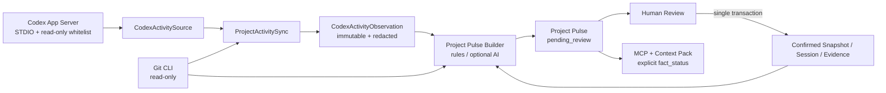
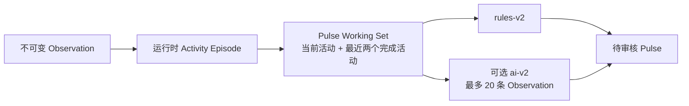
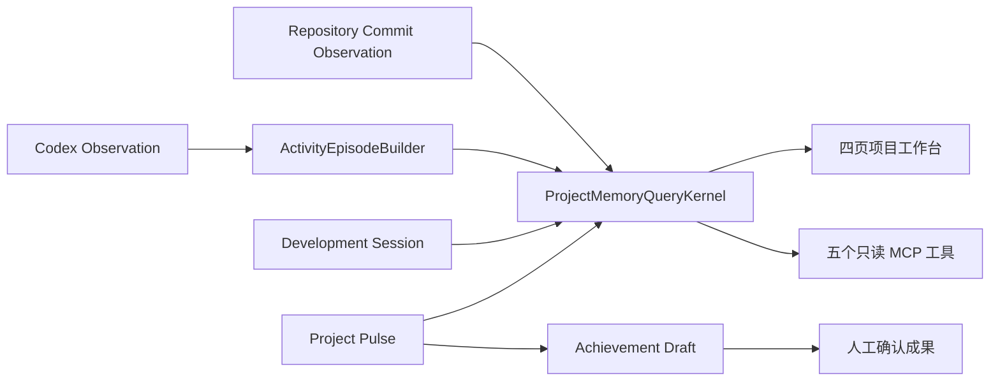
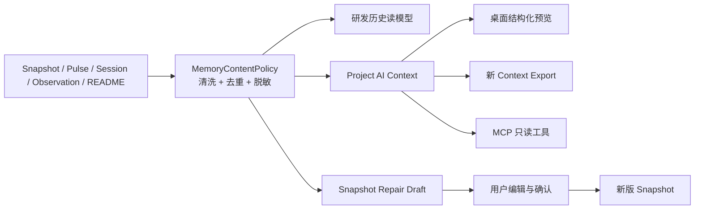

# ForgeOS 总体架构

## 架构目标

ForgeOS 采用本地优先的模块化单体架构。

D0 的目标不是实现完整业务，而是建立可以长期扩展且边界清晰的基础：

- React 只负责界面和交互
- Rust 负责应用用例、领域规则和数据访问
- SQLite 保存结构化事实
- 文件系统负责未来的附件和导出文件
- 所有外部能力通过明确的端口接入

## 总体结构

```text
React + TypeScript UI
        │
        ▼
Typed Tauri IPC
        │
        ▼
Rust IPC Layer
        │
        ▼
Application Use Cases
        │
        ├── Domain
        └── Ports
              ▲
              │
SQLite / File System / Future Adapters
```

## 前端职责

前端负责：

- 页面呈现
- 用户输入
- 即时表单校验
- 调用经过定义的 Tauri Command
- 展示 Rust 返回的只读数据和错误

前端不得：

- 直接访问 SQLite
- 绕过 Rust 修改正式数据
- 在 `localStorage` 保存正式领域事实
- 实现与 Rust 重复的核心业务状态机

## Rust 模块职责

### `bootstrap`

负责应用启动和依赖组装：

- 解析数据目录
- 初始化日志
- 建立 SQLite 连接
- 执行 Migration
- 注册 Tauri Commands
- 组装基础设施实现

### `ipc`

负责 Tauri 边界：

- Commands
- 输入与输出 DTO
- IPC 参数校验
- 错误转换

IPC 不直接执行 SQL，也不保存业务规则。

### `application`

负责应用用例编排：

- 调用领域规则
- 控制事务边界
- 调用端口
- 返回用例结果

D0 只保留模块边界，不实现完整业务用例。

### `domain`

负责领域对象和不变量。

未来承载：

- Project
- Current Snapshot
- Development Session
- Decision
- Problem
- Evidence

Domain 不依赖 Tauri、SQLx、文件系统或具体 AI SDK。

### `ports`

定义应用依赖的抽象能力，例如：

- Repository
- Clock
- ID Generator
- File Store
- Context Renderer
- AI Provider

D0 只增加当前确实需要的端口，不提前建立空泛抽象。

### `infrastructure`

实现技术细节：

- SQLite 连接
- Migration
- Repository 实现
- 文件系统
- 日志和配置
- 后续 Git、AI 等适配器

### `read_models`

负责面向界面的查询模型。

未来可承载 Dashboard、Project Overview 和 Search 投影。D0 只建立边界。

### `jobs`

负责未来可取消、可审计的后台任务，例如 Git 刷新和 AI 分析。D0 不运行后台业务任务。

## 依赖规则

固定依赖方向：

```text
IPC → Application → Domain
Application → Ports
Infrastructure → Ports
Bootstrap → 各模块组装
```

禁止：

- Domain 引用 Tauri 或 SQLx
- IPC 直接执行 SQL
- React 直接读写数据库
- Infrastructure 反向依赖 UI
- AI Provider 直接修改领域表
- 模块之间通过全局可变状态交换业务数据

## 启动数据流

```text
启动 Tauri
→ bootstrap 确定数据目录
→ 建立 SQLite 连接
→ 执行 Migration
→ 进行数据库健康检查
→ 注册 Commands
→ 创建桌面窗口
→ React 显示 Hello ForgeOS
```

如果迁移失败，应用必须返回清晰错误，不得假装正常启动。

## 普通请求数据流

```text
React
→ Typed IPC
→ IPC Command
→ Application Use Case
→ Domain Validation
→ Port
→ Infrastructure
→ SQLite Transaction
→ DTO
→ React
```

## D0 实施边界

D0 实现：

- Hello ForgeOS 窗口
- 基础布局
- Rust 模块目录
- SQLite 连接
- Migration 执行
- Rust 数据库访问验证

D0 不实现：

- 业务页面
- 完整领域模型
- AI Provider
- Git/GitHub
- Codex 集成
- 后台任务
- 完整搜索与附件系统

## 后续扩展原则

新增能力必须从 Application Use Case 进入，不允许从 UI、AI 或外部集成直接写数据库。

若未来拆出 MCP 进程，应复用领域与应用核心，而不是复制一套业务规则。

## AI Provider Foundation

AI Provider 使用独立于 ProjectKernel 的应用边界：

```text
React Provider Settings
→ Typed Tauri IPC
→ AiProviderKernel
├─ AiProviderRepository → SQLite（非敏感配置）
├─ ApiKeyStore → Windows Credential Manager（API Key）
└─ AiProviderClient → OpenAI-compatible HTTP endpoint
```

固定规则：

- Provider 新建后默认 Disabled，只有用户显式启用且显式点击 Invoke 才能发起网络请求。
- SQLite 不保存 API Key；IPC DTO 只返回 `apiKeyConfigured`，不提供明文回读接口。
- HTTP Adapter 只实现最小 Chat Completions `model + messages` 契约，不提供 tools、Agent、自动重试任务或后台调用。
- 调用结果停留在当前 UI 内存，不自动写入 Project、Snapshot、Development Session、Evidence 或其他正式事实。
- AI Provider 不依赖 Project 领域，也不能获得任何 Repository 写入能力。
- 未来 AI 建议若需要进入正式事实，必须通过独立用例、用户确认与现有版本规则；本阶段不实现。

## D1.5 Context Pack 与手动 AI 调用

Context Pack 是正式事实层之上的确定性派生记录：

```text
Project + Current Snapshot + Recent Session + Evidence
→ ContextPackKernel
→ MarkdownContextRenderer
→ ContextExport Repository
→ SQLite context_exports
```

依赖与职责固定如下：

- `ContextPackKernel` 负责按 Project 读取来源、验证来源归属、固定排序、调用 Renderer 并保存导出。
- `MarkdownContextRenderer` 是无状态 Port Adapter；相同模板与相同来源必须生成逐字节相同的 Markdown。
- `ContextExport` 保存来源 Snapshot 版本、最近 Session ID、内容 SHA-256、模板、状态和乐观版本。
- React 只能通过 Context Pack IPC 生成、列出、读取和显式发送导出，不能直接拼装正式 Context Pack。
- AI 调用通过既有 `AiProviderKernel` 执行；Disabled Provider 在网络请求前被拒绝。
- AI 成功响应后只允许把 ContextExport 从 `generated` 标记为 `sent_to_ai`；Project、Snapshot、Session、Evidence 均不提供给该调用链写权限。
- User Prompt 与 AI Response 只存在于当前调用和页面内存，不创建 Conversation、Prompt History 或 Response History。

Markdown 章节顺序固定为 Project Identity、Current Snapshot、Recent Development Session、Evidence。
Evidence 按标题与 ID 稳定排序；最近 Session 由 Repository 的确定性倒序结果选择第一条。

## D1.6 AI Candidate 治理层

AI Candidate 位于临时 AI Response 与正式事实之间：

```text
Context Pack → Manual AI Invocation → Temporary Response
                                      │
                                      ├─ 仅查看（不持久化）
                                      └─ 用户显式保存 → Pending AICandidate
                                                            │
                                                            ├─ Accepted
                                                            ├─ Rejected
                                                            └─ Archived
```

固定边界：

- `AiCandidateKernel` 只持有 Workspace/Project/ContextExport 的读取能力与 AICandidate Repository；不持有 Snapshot、Session、Evidence 的写入 Port。
- AI Response 默认仍是页面内存数据，创建 Candidate 是用户执行的第二个独立操作。
- Domain 创建入口不接受 status 参数，所有新 Candidate 固定为 `pending / version = 1`。
- Accept、Reject、Archive 都是从 Pending 出发的单向终态；终态内容与状态保持只读。
- Accept 只表达“用户认可这条建议”，不会调用任何正式领域 Application Use Case。
- Application 与数据库复合外键同时验证 Candidate 和来源 ContextExport 属于同一 Project。
- 所有 Review 使用 `expectedVersion`；Repository 的 UPDATE 还要求持久化状态仍为 Pending，防止并发双重审核。

## D2 Git 只读观察与 Evidence

Git 集成使用独立 RepositoryKernel：

```text
React Repository Page
→ Typed IPC
→ RepositoryKernel
├─ GitAdapter → git CLI（固定只读命令）
└─ RepositoryStore → SQLite
     ├─ Repository metadata
     ├─ immutable WorkingCopy observations
     └─ Git Evidence + repository source link
```

固定边界：

- GitCliAdapter 不接受任意子命令，只实现 `rev-parse`、`symbolic-ref`、`remote get-url`、`status`、`diff`、`log` 和 `show`。
- 每个命令通过参数数组启动，不经过 shell；设置 `GIT_OPTIONAL_LOCKS=0`、禁用交互认证并使用十秒超时。
- Adapter 没有 commit、push、pull、merge、checkout、reset 或 stash 方法与命令分支。
- Register 和 Refresh 先读取外部状态，再在单个 SQLite 事务中保存 Repository/WorkingCopy；不向 Git 工作区写入。
- Repository 保存集成身份和最近检查元数据；每次 Refresh 追加新的 WorkingCopy，保留观察历史。
- Git Commit/Status Evidence 仍使用 Evidence Domain，默认 `unverified`，用户可在 Evidence 页面人工 Verify/Invalidate。
- Generic Evidence IPC 不能创建或改写 Git Evidence；Git 类型只能通过 RepositoryKernel 的受控采集入口产生。
- `repository_evidence_links` 使用 Evidence 与 Repository 的复合 Project 外键，确保外部事实不会跨项目串线。
- Remote URL 在持久化前移除 HTTP(S) user-info，防止嵌入式凭据进入 SQLite。

## D3 MCP Read-only Architecture

ForgeOS MCP 是独立的本地 Rust 进程，只向外部 AI 客户端提供已经确认的研发语义上下文：

```text
Codex / MCP Client
        ↓ STDIO JSON-RPC
forgeos-mcp Protocol + Tool Layer
        ↓ read-only query methods
McpQueryKernel
        ↓ existing repository ports + ContextRenderer
SqliteProjectRepository
        ↓ read-only SQLite connection
ForgeOS Database
```

职责与依赖边界：

- `forgeos-mcp` 只负责 MCP 协议、JSON Schema、参数校验、结果脱敏和错误映射，不包含领域规则或 SQL。
- `McpQueryKernel` 位于 ForgeOS Core 的 Application 层，只持有 `McpQueryRepository` 和 `ContextRenderer`，不暴露任何 create/update/delete 用例。
- `connect_read_only` 只打开已存在的数据库，不创建文件、不运行 Migration、不改变 Journal Mode。
- `build_context_pack` 复用现有确定性 Markdown Renderer，在内存中构建并计算哈希，不插入或更新 `context_exports`。
- 每个 Tool 都要求 `project_id`；Kernel 先在当前 Workspace 中确认 Project，再按该 Project 查询 Snapshot、Session 和 Evidence。
- MCP DTO 不包含 Evidence `source_uri`、Repository path、AI Provider、API Key、Credential 或 Token。
- STDOUT 只承载 MCP JSON-RPC；服务器不监听 HTTP 或 TCP，不提供 Resources、Prompts、Tasks 或写工具。

第一版固定工具面：

- `get_project_identity`
- `get_current_snapshot`
- `get_recent_sessions`
- `list_evidence`
- `build_context_pack`

GitHub MCP 继续负责 Repository、Commit、Issue、Pull Request、Release 和 CI 等托管平台事实。ForgeOS MCP 不重复浏览代码仓库，只解释 Project 目标、当前状态、研发过程、证据链和 Context Pack。两类上下文可由客户端组合，但彼此没有写权限传递。

## D4.5 GitHub Read-only Import Architecture

```text
GitHub Repository URL
→ GitHubImportKernel
├─ GitHubClient → GitHub REST API（只读 GET）
├─ ApiKeyStore → Windows Credential Manager
└─ GitHubImportRepository → SQLite Import Draft
                              ↓ human review
                         atomic Project + Evidence import
```

- GitHub API 逻辑隔离在 `infrastructure/github`，核心 Project、Evidence 与 IPC 不包含 HTTP 细节。
- Connector 默认无认证，只能读取公开仓库；可选 Token 只从 Credential Manager 注入请求头，不进入日志、SQLite 或返回 DTO。
- API Adapter 只实现 Repository、Languages、Topics、README、最近 Commit 与最新 Release 的读取，不定义任何 GitHub 写方法。
- Draft 是外部事实进入 ForgeOS 前的隔离区。生成 Draft 不创建 Project；必须经过用户 `review` 后才能执行 Import。
- Import Repository 在单事务中创建 Project、把 Draft 标记为 Imported，并写入带来源链的 GitHub Evidence。
- Reject 保留 Draft 历史且不创建 Project。系统不提供后台轮询、Webhook 或自动同步入口。
- Project Overview 仅显示已导入来源，不把 GitHub 字段自动覆盖回 Project Identity。

## D5 Codex Execution Foundation

```text
Approved CodexTaskProposal
→ CodexExecutionKernel
├─ CodexRunner Port → RecordOnlyCodexRunner（不启动进程）
└─ CodexExecutionRepository → SQLite
     ├─ Execution Record
     └─ append-only Status History
```

- Proposal 是经过人工批准的任务契约；Execution 是引用该契约的一次独立执行尝试。
- 只有同一 Project 的 Approved Proposal 可以创建 `pending` Execution。Approve 本身仍不创建 Execution。
- Domain 管理 `pending → running → success | failed | cancelled` 与 `pending → cancelled` 状态机、时间字段和乐观版本。
- Application 负责 Project/Proposal 归属、批准状态和并发检查；Repository 在事务中更新记录并追加历史。
- `CodexRunner` 是未来执行适配器端口。D5 的 `RecordOnlyCodexRunner` 仅接受请求元数据，不调用 `codex exec`、不读取或修改代码、不运行验证命令。
- React 通过类型化 IPC 创建请求、查看历史和显式记录状态/结果，不直接访问 SQLite。
- ExecutionKernel 没有 Snapshot、Session 或 Evidence 写入能力；成功、失败或取消都不会改变正式研发事实。
- D5 不使用 `jobs` 模块，不实现后台队列、进度流、Agent、MCP 写入或 Git 自动化。

## D5 MCP Intelligence Layer（方向调整）

ForgeOS 后续不继续扩展 Codex Execution。既有 Execution Foundation 仅保留为历史记录能力；当前 D5 的研发方向调整为增强只读 MCP 查询，让 Codex 在自己的工作环境中消费 ForgeOS 已确认的研发知识：

```text
Codex / MCP Client
        ↓ STDIO JSON-RPC
forgeos-mcp Protocol + Safe Result DTO
        ↓ read-only query methods
McpQueryKernel
        ↓ Application Query + Repository Port
SqliteProjectRepository
        ↓ SQLite read-only connection
ForgeOS Database
```

依赖与职责保持固定：

- MCP Tool 层只负责协议转换、参数校验、结果 DTO 和安全错误映射，不包含 SQL、领域规则或推荐规则。
- `McpQueryKernel` 负责 Project 归属验证、查询编排、确定性排序、安全投影与规则型建议；它不持有任何 Mutation Use Case。
- `McpQueryRepository` 只提供查询所需的 Repository Port；MCP Server 不直接访问 SQLite。
- SQLite 继续通过 `connect_read_only` 打开，不创建数据库、不执行 Migration，也不允许写事务。
- 每次请求必须显式绑定 `project_id`，所有 Snapshot、Session、Evidence、Git Activity 和 Candidate 查询都在该 Project 范围内完成。

在保留 D3 五个只读工具兼容面的基础上，新增以下 Intelligence Tools：

- `get_project_overview`
- `get_current_state`
- `get_development_history`
- `get_recent_git_activity`
- `get_project_evidence_summary`
- `get_recommended_next_steps`

`get_recommended_next_steps` 是确定性规则查询，不是 AI 推理。规则只读取 Current Snapshot、Open Session、Pending Candidate 与尚未确认的 Evidence，使用固定优先级、固定排序和去重策略生成建议。同一份数据库状态必须返回相同结果；Candidate 仍然只是候选内容，建议结果不会接受 Candidate 或改变正式事实。

`build_context_pack` 继续只在内存中生成，并按固定顺序组织：

1. Project Overview
2. Current Snapshot
3. Recent Development Session
4. Evidence Summary
5. Recent Git Activity

Renderer 使用稳定字段顺序和稳定来源排序计算 Markdown 与 SHA-256。Git Evidence 在 Git Activity 中形成安全结构化摘要，不重复输出为普通 Evidence，也不返回 Evidence `source_uri`、Repository 绝对路径或原始路径字段。

安全边界：

- MCP Result DTO 使用字段白名单，不直接序列化 Repository、Evidence 或 AI Provider 实体。
- 禁止返回 API Key、Credential、Token、Provider Secret、Repository 私有绝对路径或嵌入凭据的 URL。
- MCP 不调用 AI，不启动 Agent，不执行 Codex，不启动 Shell，也不执行任何 Git 命令。
- MCP 不创建、更新或删除 Project、Snapshot、Session、Evidence、Candidate、ContextExport 或其他 ForgeOS 记录。
- STDIO 仍是唯一 Transport；不监听 HTTP/TCP，不提供写 Tool、Task 执行或后台任务。
# D6 Codex Activity Intake 与 Project Pulse

D6 在既有模块化单体中增加“只读观察 → 待审核投影 → 人工确认事实”链路：



## 模块职责

- `ports::CodexActivitySource`：只定义健康检查和按 Repository 读取活动，不暴露任意 App Server 方法。
- `infrastructure::codex_activity`：发现 `codex.exe`、管理 STDIO 子进程、执行方法白名单、过滤根任务、规范化与脱敏轮次。
- `ProjectPulseKernel`：协调 Codex、Git、游标、SyncRun、规则分析、可选 AI 回退、Pulse 历史与确认事务。
- `ProjectActivityRepository`：持久化 Connector、Project 设置、SyncRun、Cursor、Observation、Pulse 与来源链。
- `jobs`：仅在 ForgeOS 进程存活时每分钟检查 `interval_30m` 项目；不创建 Windows Service 或计划任务。
- Project Pulse 前端：展示同步进度、结构化草稿、来源、正式事实对比和确认选项。
- `McpQueryKernel`：只读返回最新保存 Pulse，不触发桌面同步。

## App Server 契约与白名单

允许：`initialize`、`thread/list`、`thread/read(includeTurns=true)`、`thread/goal/get`。

拒绝：任务创建/恢复/归档/删除、轮次启动/引导、命令或进程执行、元数据更新及其他未声明方法。第一版不依赖实验性的 `thread/turns/list`。

## 后台同步数据流

1. IPC 创建 `queued` SyncRun 并立即返回 ID。
2. 后台任务将阶段依次更新为 connecting、reading_codex、reading_git、analyzing、persisting。
3. Codex Observation 以 `(repository_id, thread_id, turn_id)` 幂等插入；游标只在 Repository 读取成功后前进。
4. Git 为 Project 的每个 Repository 创建新的不可变 WorkingCopy 观察；ahead/behind 基于本地远端引用且不执行 fetch。
5. 来源指纹未变化时不生成 Pulse、不调用 AI。
6. 新来源先生成规则 Pulse；项目显式启用 Provider 后才尝试固定 JSON AI 分析，失败回退规则结果并把 SyncRun 标记为 partial。
7. Tauri 事件提供即时进度，数据库中的 SyncRun 支持刷新页面后恢复展示。

Codex Connector 不可用时，SyncRun 继续完成 Git 检查和规则 Pulse，并以 `partial` 保存可读原因；AI Provider 不可用时也只降级到规则摘要。只有 Project 未连接任何本地 Repository 时，同步才在进入外部读取前失败并给出连接引导。

打开项目触发默认同步，同一 Project 五分钟内防抖；手动同步绕过该防抖，但不会与 queued/running 同步重叠。`interval_30m` 只在桌面进程存活时运行，Windows 睡眠出现较大时间间隔后额外等待一分钟，不安装 Service 或计划任务。

## 安全投影

数据库、AI 和 MCP 都不接收原始 reasoning、完整命令输出、环境变量、凭据、完整 Diff 或仓库外绝对路径。Repository 路径只用于桌面端 Project 隔离；进入观察文本前替换为 `<repo>`，其他绝对路径与 Key、Token、Authorization、Password 等值会被省略或替换。MCP 继续使用 SQLite read-only 连接，新增 `get_project_pulse` 也只能读取最近保存投影。

新生成的 Context Pack 固定在 Confirmed Current Snapshot 之后加入 `Observed Activity - Unconfirmed`。已确认 Pulse 不重复冒充观察事实；旧 ContextExport 不回写。MCP 的 Pulse 新鲜度来自最近成功 SyncRun：30 分钟模式超过 60 分钟为 stale，打开/手动模式超过 24 小时为 stale。

## D6.1 Project Pulse Quality Pipeline



- Episode 不持久化；8 小时、20 轮次和 72 小时边界只在 Application 层确定性计算。
- 旧 `legacy-v1` Pulse、Snapshot 与 Session 永久保留。由旧 Pulse 创建的 Snapshot/Session 不重新注入 rules-v2，防止历史摘要反馈污染。
- Blockers 只使用当前 Episode 的失败/未解决错误与可信正式 Blocker；Evidence、Candidate 和普通 Git Dirty 不再混入研发阻塞。
- Git 状态作为独立观察展示，只能形成 Next Step 提醒，不能改变活动语义。
- AI 只能接收规则草稿、Working Set、Git 摘要和可信正式事实，不能读取全部历史；非法结果修复一次后回退 rules-v2。
- MCP 与 Context Pack 只读暴露 Activity Type、分析修订和来源数量；MCP 仍不能触发同步或写入。

## D6.4 应用语言与通俗表达层

ForgeOS 在领域与页面之间增加独立的显示层，不改变任何正式研发事实：

```text
SQLite app_preferences
        ↓
AppPreferencesKernel / IPC
        ↓
AppPreferencesProvider
        ↓
i18next 静态资源 + 状态字典 + 错误本地化
        ↓
通俗中文或英文界面
```

- `AppPreferencesKernel` 只负责本机语言和术语提示偏好，通过乐观版本避免多窗口互相覆盖。
- Provider 在 Workspace 加载前解析实际语言，避免先显示默认英文再切换造成闪烁；读取失败时临时跟随系统语言，不阻止应用启动。
- 页面标题、说明、主要操作、空状态、日期、枚举和错误提示进入显示层；Project、Snapshot、Session 等领域对象仍使用原有模型。
- 用户填写内容、Git/GitHub 原文、AI 回复、Context Pack、MCP 返回和哈希不经过翻译，也不会因语言切换重新计算。
- 英文术语提示是中文界面的辅助显示，不进入导航、主要按钮或正式数据。

## D7 研发记忆聚合架构



- `ActivityEpisodeBuilder` 从 Pulse 中提取为共享 Application 组件，Pulse 与研发历史不得复制分段规则。
- `ProjectMemoryQueryKernel` 提供项目批量摘要、概览、游标历史、确定性 AI Context 和 Repository Path 定位。
- Git 首次回溯近一年、最多 2,000 条安全 Commit 元数据；不保存 Diff、正文、邮箱或绝对路径输出。
- 研发历史不建立重复事件表。Codex Episode 为主要单位，时间窗内 Commit 附加到活动，未匹配 Commit 按仓库和自然日聚合。
- Achievement 是正式成果领域。规则只生成 Draft；确认、更新与归档继续经过 Domain、Application、Repository 和 IPC。
- Dashboard 与 Project List 合并；React 使用一个批量 IPC 获取项目记忆摘要，避免逐项目请求。
- Candidate、Task Proposal 和 Execution 只保留 list/get Command；写 Command 不再注册到 Tauri。

MCP 最终工具面为 `list_projects`、`get_project_context`、`get_project_history`、`get_project_achievements`、`build_ai_context`。所有核心工具接受 Project ID 或 Repository Path 二选一。路径只用于当前请求匹配，支持 Windows 大小写不敏感和子目录匹配，嵌套仓库选择最长注册路径；路径不进入日志和返回结果。

## 研发记忆质量与安全投影



- `MemoryContentPolicy` 位于 Application 层，是提示包装清理、语义去重、README 摘录、路径/Secret 脱敏和长度预算的唯一实现。
- 质量问题返回稳定代码与 warning/blocking 等级；前端负责本地化，不解析英文错误消息。
- 研发历史在读取时去除重复 Activity/Outcome，不修改旧 Observation；Manual Session Notes 只作为活动摘要。
- Snapshot Repair Draft 是只读建议。保存仍经过 Snapshot Domain 与乐观版本检查，旧版本永久保留。
- AI Context 的结构化字段和 Markdown 来自同一安全投影；Hash 对最终 Markdown 计算。旧 ContextExport 永不重算。
- blocking Context 不允许复制、生成新 Export 或通过 MCP 返回 Markdown；MCP 仍不触发同步、不写数据库。
