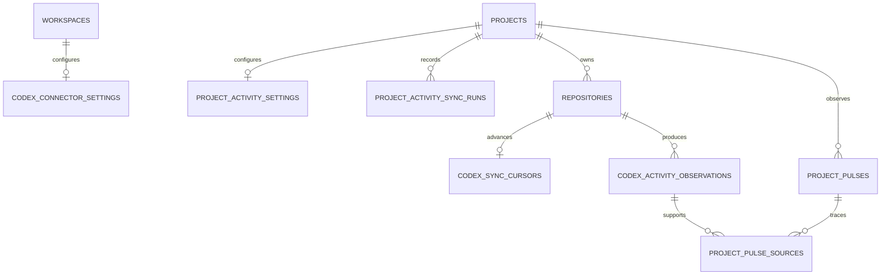

# ForgeOS 数据库设计

## 当前范围

D5 数据库承载 ForgeOS 的研发记忆、外部事实、AI 治理、Codex 提案与执行记录基础，包含：

- 单用户的唯一 `Workspace`
- 归属于该 Workspace 的多个 `Project`
- 归属于 Project、按版本只追加保存的 `ProjectSnapshot`
- 归属于 Project、记录一次研发活动及其交接信息的 `DevelopmentSession`
- 归属于 Project、保存事实依据及人工验证状态的 `Evidence`
- 将 Evidence 统一关联到 Project、Snapshot 或 Session 的 `EvidenceLink`
- 只保存非敏感连接配置与启停状态的 `AiProvider`
- 保存确定性派生 Markdown 与来源版本的 `ContextExport`
- 保存 AI 建议与人工审核结果、但不成为正式事实的 `AICandidate`
- 保存 Project 与本地 Git 工作区关联的 `Repository`
- 保存每次只读检查结果的不可变 `WorkingCopy`
- 追溯 Git Evidence 来源 Repository 的 `RepositoryEvidenceLink`
- 保存受 ContextExport 约束且经过人工审批的 `CodexTaskProposal`
- 保存 GitHub 只读导入连接状态与人工审核草稿
- 保存一次 Codex 执行请求、状态、结果与只追加历史的 `CodexExecutionRecord`

Current Snapshot 只表达“项目现在真实处于什么状态”，Development Session 只表达“一次研发活动发生了什么”，Evidence 只表达“支持该事实的依据是什么”。ContextExport 是上述事实的可验证派生记录；AICandidate 是待人工治理的 AI 建议。Repository/WorkingCopy 与 GitHub Import 是外部只读事实来源，不是版本控制器。CodexTaskProposal 是人工审批的任务契约，CodexExecutionRecord 只是执行生命周期记录。本阶段不创建 Conversation、Prompt/Response History、Decision、Problem、Agent、MCP 写入、Search 或 Timeline 相关表，也不保存真实 Codex 进程输出流。

## 技术选择

- 数据库：SQLite
- 访问层：Rust + SQLx
- Migration：由应用启动流程执行
- 前端访问：禁止，React 必须通过类型化 Tauri IPC 调用 Rust
- Migration 源文件：`database/migrations`
- 运行时数据库：默认位于 Tauri 应用数据目录，也可通过 `FORGEOS_DATA_DIR` 指定；本地验证可使用被 Git 忽略的 `.data/forgeos.db`

## 通用约定

- 表名和列名使用 `snake_case`
- ID 使用 `TEXT`，由 Rust 生成
- 时间使用 UTC RFC 3339 文本
- SQLite 连接开启外键约束
- 所有查询使用参数化 SQL
- Migration 只向前追加，已经应用的 Migration 不得修改
- 开发数据库和 Migration 源文件必须分离
- SQLite 数据库及 WAL/SHM 文件不提交到 Git
- 删除与归档是不同语义；Project 归档通过状态变更完成，不删除记录
- 结构化文本列表在 SQLite 中保存为 JSON 文本，由 Domain 与 Repository 边界负责校验和转换

## `workspaces`

表示 ForgeOS 当前的顶层工作空间。

| 字段 | 类型 | 约束 | 说明 |
|---|---|---|---|
| `id` | TEXT | PRIMARY KEY | Workspace ID |
| `name` | TEXT | NOT NULL | Workspace 名称 |
| `timezone` | TEXT | NOT NULL | 用户显示时区 |
| `created_at` | TEXT | NOT NULL | UTC 创建时间 |
| `updated_at` | TEXT | NOT NULL | UTC 更新时间 |

### Workspace 规则

- D1.1 只支持单个 Workspace，不实现多用户、Workspace 切换或权限。
- `name` 和 `timezone` 必须是去除首尾空白后的非空文本。
- 创建 Workspace 时，应用用例先检查当前 Workspace；已存在时拒绝再次创建。
- 数据库通过唯一常量表达式索引提供第二层单例保护，避免并发请求插入第二条 Workspace。
- Workspace 已被 Project 引用时不得静默删除；D1.1 不提供删除 Workspace 的用例。

## `projects`

Project 表示 ForgeOS 管理的软件项目身份，也是后续研发记录的归属边界。

| 字段 | 类型 | 约束 | 说明 |
|---|---|---|---|
| `id` | TEXT | PRIMARY KEY | Project ID |
| `workspace_id` | TEXT | NOT NULL, FOREIGN KEY | 所属 Workspace |
| `slug` | TEXT | NOT NULL | Workspace 内稳定的机器可读标识 |
| `name` | TEXT | NOT NULL | 项目名称 |
| `description` | TEXT | NOT NULL | 项目简短描述 |
| `vision` | TEXT | NOT NULL | 项目长期愿景 |
| `target_user` | TEXT | NOT NULL | 目标用户 |
| `scope` | TEXT | NOT NULL | 当前产品范围 |
| `non_goals` | TEXT | NOT NULL | 明确排除的目标 |
| `tech_stack` | TEXT | NOT NULL | 技术栈说明 |
| `status` | TEXT | NOT NULL, CHECK | 项目生命周期状态 |
| `lifecycle_stage` | TEXT | NOT NULL, CHECK | 当前研发阶段 |
| `priority` | INTEGER | NOT NULL, CHECK | Workspace 内的相对优先级，范围 `0..100` |
| `created_at` | TEXT | NOT NULL | UTC 创建时间 |
| `updated_at` | TEXT | NOT NULL | UTC 更新时间 |
| `version` | INTEGER | NOT NULL, CHECK | 从 `1` 开始的乐观并发版本号 |

### Project 状态枚举

`status` 只允许：

- `idea`
- `planned`
- `active`
- `paused`
- `maintenance`
- `archived`

`lifecycle_stage` 只允许：

- `discovery`
- `definition`
- `design`
- `implementation`
- `validation`
- `release`
- `operation`
- `retrospective`

枚举值同时由 Domain 类型和数据库 `CHECK` 约束保护。数据库约束负责阻止非法持久化，具体业务校验由 Domain 负责。

### Project 约束与索引

- `workspace_id` 引用 `workspaces.id`。
- 删除 Workspace 时采用 `RESTRICT` 语义，避免静默丢失 Project。
- `workspace_id + slug` 使用不区分大小写的唯一索引；不同 Workspace 的同名 slug 为未来扩展保留语义，但 D1.1 仍只有一个 Workspace。
- `slug` 由小写 ASCII 字母、数字和连字符组成，长度为 `2..64`，由 Domain 校验。
- `name` 必须是去除首尾空白后的非空文本。
- `priority` 取值 `0..100`，默认值为 `50`。
- `version` 初始值为 `1`；每次成功更新或归档后递增。
- 为 `workspace_id + updated_at` 建立列表查询索引，支持 Dashboard 和 Projects 页面按最近更新时间读取。
- 为 `workspace_id + status` 建立状态过滤索引，为后续受控查询扩展保留基础。

### 更新与归档

Project 更新使用乐观并发控制：

```text
读取 Project(version = N)
→ 用户提交更新并携带 expected_version = N
→ UPDATE ... WHERE id = ? AND version = N
→ 成功时 version = N + 1
→ 未更新任何行时返回并发冲突，不覆盖较新的事实
```

归档是将 `status` 改为 `archived` 的专用用例，同样检查预期版本并递增 `version`。普通更新用例不接受目标状态 `archived`，已归档 Project 也不能通过普通更新继续编辑。归档不会删除 Project，也不会破坏未来研发记录的归属与审计链。

## `project_snapshots`

ProjectSnapshot 保存某个 Project 在一次人工确认时的真实状态。每次更新都插入新版本，既有版本不原地修改；某个 Project 的最高版本就是其 Current Snapshot。

| 字段 | 类型 | 约束 | 说明 |
|---|---|---|---|
| `id` | TEXT | PRIMARY KEY | Snapshot 版本的稳定 ID |
| `project_id` | TEXT | NOT NULL, FOREIGN KEY | 所属 Project |
| `version` | INTEGER | NOT NULL, CHECK | Project 内从 `1` 开始连续递增的版本号 |
| `current_goal` | TEXT | NOT NULL | 当前最重要目标 |
| `status_summary` | TEXT | NOT NULL | 当前整体状态总结 |
| `achievements` | TEXT | NOT NULL | JSON 文本数组，保存最近验证成果 |
| `blockers` | TEXT | NOT NULL | JSON 文本数组，保存当前阻塞 |
| `next_steps` | TEXT | NOT NULL | JSON 文本数组，保存最多三个下一步方向 |
| `confirmed_at` | TEXT | NOT NULL | 用户确认该版本事实的 UTC 时间 |
| `created_at` | TEXT | NOT NULL | 该版本创建的 UTC 时间 |
| `updated_at` | TEXT | NOT NULL | 该版本写入的 UTC 时间；不可变版本不会再被更新 |

### Snapshot 归属与内容规则

- `project_id` 必须引用真实存在的 `projects.id`；外键采用 `ON UPDATE CASCADE` 与 `ON DELETE RESTRICT`，禁止产生孤立 Snapshot 或静默删除历史。
- 一个 Project 在首次创建前可以没有 Snapshot，创建后在任一时刻最多只有一个 Current Snapshot；Current 不是可变标记，而是按 `project_id` 读取 `version` 最大的记录所得的确定性投影。
- 首次创建 Snapshot 时版本必须为 `1`；后续更新只能追加 `N + 1`，不能覆盖、删除或跳过已有版本。
- `achievements`、`blockers` 与 `next_steps` 在 Domain 中表现为结构化字符串列表，在 SQLite 中编码为 JSON 文本数组。
- `current_goal` 与 `status_summary` 去除首尾空白后必须非空，单字段最长 20,000 个字符；数据库也拒绝空白内容。
- 列表项会去除首尾空白、忽略空项并按首次出现去重；单项最长 2,000 个字符。数据库使用 `json_valid` 与 `json_type = 'array'` 防止非数组 JSON 持久化。
- `next_steps` 最多包含三项；超过限制时 Domain 必须在持久化之前拒绝。
- `confirmed_at` 表示用户确认状态事实的时间，不由 AI、Git 或其他自动化来源代替确认。
- 已归档 Project 的身份与 Snapshot 历史仍可读取，但不能继续创建或更新 Snapshot。
- Snapshot 不包含任务完成状态、负责人、截止日期、进度百分比或看板列。

### Snapshot 版本与并发

Snapshot 更新采用追加版本与乐观并发检查：

```text
读取 Current Snapshot(version = N)
→ 用户编辑并提交 expected_version = N
→ Application 确认 expected_version = N 并校验领域规则
→ INSERT version = N + 1
→ Current Snapshot 确定性地变为最高版本 N + 1
→ 并发写入由 UNIQUE(project_id, version) 拒绝重复版本
→ 回读最新版本并返回并发冲突，不覆盖较新的事实
```

`project_id + version` 必须唯一。该约束既保护每个 Project 的版本序列，也使并发写入无法创建两个相同版本。历史查询按版本倒序返回完整记录；Current 查询使用同一版本序列的最高版本，不维护额外的可变指针、`is_current` 标志或 Project 表字段。

### Snapshot 索引

- `UNIQUE(project_id, version)` 保证 Project 内版本唯一，并支持按 Project 查询版本。
- 为 `project_id + version DESC` 的 Current 与历史读取提供索引能力；具体索引由 Migration 定义，避免扫描其他 Project 的历史。
- Snapshot 写入只通过 Application 用例执行，并且只能追加 `INSERT`；Repository 不向前端暴露 SQL 或 JSON 存储细节。

## `development_sessions`

DevelopmentSession 是一次有明确开始原因和结束结果的研发活动，是 ForgeOS 记录研发过程的最小单位。它围绕目标、过程、结果、验证与接手信息形成闭环，但不承担任务分解、工时统计或进度管理职责。

| 字段 | 类型 | 约束 | 说明 |
|---|---|---|---|
| `id` | TEXT | PRIMARY KEY | Session ID |
| `project_id` | TEXT | NOT NULL, FOREIGN KEY | 所属 Project |
| `status` | TEXT | NOT NULL, CHECK | `open`、`completed` 或 `abandoned` |
| `goal` | TEXT | NOT NULL | 本次研发活动的目标 |
| `notes` | TEXT | NOT NULL, DEFAULT `''` | 研发过程中的 Markdown 文本 |
| `outcome` | TEXT | NOT NULL, DEFAULT `''` | 完成时确认的结果 |
| `validation` | TEXT | NOT NULL, DEFAULT `''` | 完成结果如何被验证 |
| `handoff` | TEXT | NOT NULL, DEFAULT `''` | 下一次继续开发所需的接手信息 |
| `started_at` | TEXT | NOT NULL | Session 开始的 UTC 时间 |
| `completed_at` | TEXT | NULL | 离开 `open` 状态的 UTC 时间；Open 时为空 |
| `created_at` | TEXT | NOT NULL | 记录创建的 UTC 时间 |
| `updated_at` | TEXT | NOT NULL | 最近一次合法状态变更的 UTC 时间 |
| `version` | INTEGER | NOT NULL, CHECK | 从 `1` 开始的乐观并发版本号 |

### Session 生命周期与内容规则

Session 使用单向状态机：

```text
             ┌─────────── completed
open ────────┤
             └─────────── abandoned
```

- 新建 Session 必须从 `open` 开始；不允许直接创建终态记录。
- `open` 可以更新目标和过程 Notes，也可以通过专用用例变为 `completed` 或 `abandoned`。
- `completed` 与 `abandoned` 都是终态：不能重新打开、相互转换或继续修改目标、过程、结果、验证和 Handoff。
- `completed_at` 表示 Session 离开 `open` 的时间，因此完成和放弃时都必须写入；Open Session 必须保持为空。字段名沿用产品模型，业务语义由状态共同解释。
- `goal` 去除首尾空白后必须非空，最长 2,000 个字符。`notes` 使用 Markdown 文本保存，不在数据库中解析为任务或其他子实体；Notes 最长 20,000 个字符。
- Open Session 的 `outcome`、`validation` 与 `handoff` 必须为空，避免在尚未结束时把草稿误认为已确认结果。
- 完成 Session 时，`outcome`、`validation` 与 `handoff` 去除首尾空白后都必须非空；三个收尾文本字段分别最长 20,000 个字符。
- 放弃 Session 不声称取得或验证了结果，因此 `outcome` 与 `validation` 必须为空；`handoff` 去除首尾空白后必须非空且最长 20,000 个字符，用于保存再次尝试或转向其他方案时需要知道的上下文。
- 以上状态内容规则由 Domain 与数据库约束共同保护，React 只提交类型化意图。
- `project_id` 必须引用真实存在的 `projects.id`；外键使用 `ON UPDATE CASCADE` 与 `ON DELETE RESTRICT`，不得产生孤立 Session 或因删除 Project 静默丢失研发历史。
- Project 首次开始研发活动前可以没有 Session。Session 历史永久保留，终态记录不会因开始下一次 Session 被覆盖。
- 已归档 Project 不能开始新 Session，也不能继续编辑既有 Open Session 的 Goal 或 Notes。若 Project 归档前遗留 Open Session，仍允许通过专用用例完成或放弃，以免留下无法收尾的永久 Open 记录。
- Session 不包含 Task、截止日期、负责人、工时、Commit 或 Git 分支。Evidence 关联保存在独立 `evidence_links` 表中，不反向修改 Session。

### 每个 Project 最多一个 Open Session

数据库使用带条件的唯一索引作为并发安全边界：

```sql
CREATE UNIQUE INDEX ...
ON development_sessions(project_id)
WHERE status = 'open';
```

该约束只限制 `open` 状态，因此同一 Project 可以保留任意数量的 `completed` 和 `abandoned` 历史记录。Application 会先查询 Current Session 并返回清晰的领域错误；即使多个窗口同时发起开始请求，SQLite 部分唯一索引仍只允许一个请求成功。

### Session 更新与乐观并发

`version` 初始为 `1`。所有 Open Session 编辑和终态转换都必须携带 `expected_version`：

```text
读取 Open Session(version = N)
→ 用户提交 expected_version = N
→ Domain 校验允许的状态转换与内容
→ UPDATE ... WHERE id = ? AND status = 'open' AND version = N
→ 成功时 version = N + 1，updated_at 同步更新
→ 未更新任何行时回读记录，区分不存在、已进入终态与版本冲突
```

完成与放弃必须在同一条受状态和版本保护的写入中更新终态、收尾字段、`completed_at` 和 `version`，不能先保存结果再单独改变状态。终态 Session 只有读取能力，不提供普通更新或再次转换入口。

### Session 索引

- 条件唯一索引 `(project_id) WHERE status = 'open'` 保证一个 Project 最多一个 Open Session，并直接支持 Current Session 查询。
- Project 历史索引按 `project_id` 与开始时间倒序组织，支持 Session History 在不扫描其他 Project 的前提下返回最近活动。
- Session 写入只能通过 Application 用例执行；React 不接触 SQL、状态机或版本更新细节。

## `evidences`

Evidence 保存支持研发事实的人工证据。它直接归属于 Project，但不承担 Snapshot 当前状态或 Session 研发过程本身的职责，也不会反向修改二者。

| 字段 | 类型 | 约束 | 说明 |
|---|---|---|---|
| `id` | TEXT | PRIMARY KEY | Evidence ID |
| `project_id` | TEXT | NOT NULL, FOREIGN KEY | 所属 Project |
| `title` | TEXT | NOT NULL, CHECK | 证据名称，去除首尾空白后非空 |
| `description` | TEXT | NOT NULL, DEFAULT `''` | 证据说明 |
| `type` | TEXT | NOT NULL, CHECK | Evidence 内容类型 |
| `source_type` | TEXT | NOT NULL, CHECK | 来源类型 |
| `source_uri` | TEXT | NOT NULL, DEFAULT `''` | 本地路径、外部 URL；人工记录可为空 |
| `verification_status` | TEXT | NOT NULL, CHECK | `unverified`、`verified` 或 `invalid` |
| `created_at` | TEXT | NOT NULL | 创建 UTC 时间 |
| `updated_at` | TEXT | NOT NULL | 最近一次内容或验证状态变化的 UTC 时间 |
| `version` | INTEGER | NOT NULL, CHECK | 从 `1` 开始的乐观并发版本号 |

### Evidence 类型与来源

`type` 只允许：

- `document`
- `screenshot`
- `link`
- `test_result`
- `note`
- `artifact`
- `git_commit`
- `git_status`

`source_type` 只允许：

- `local_file`：`source_uri` 保存用户提供的文件路径。
- `external_url`：`source_uri` 必须是以 `http://` 或 `https://` 开始的 URL。
- `manual_note`：事实来源为用户直接记录，`source_uri` 可以为空。

普通 Evidence 只保存来源引用，不复制附件、不检查本地文件是否存在、不抓取 URL 内容。`git_commit` 与 `git_status` 只能由 D2 RepositoryKernel 通过只读 Git 观察创建，通用 Evidence Create/Update 用例不能伪造或改写其内容。Git Evidence 初始仍为 `unverified`，允许用户人工 Verify/Invalidate。标题最长 200 个字符，说明最长 20,000 个字符，来源 URI 最长 2,048 个字符；具体文本规则由 Domain 执行，数据库同时保护必填和枚举边界。

### 验证状态与版本

- 新 Evidence 固定从 `unverified` 与 `version = 1` 开始。
- `verify_evidence` 将状态变为 `verified`；`invalidate_evidence` 将状态变为 `invalid`。
- 内容更新、验证和失效都必须携带 `expected_version`，成功后版本递增。
- 任何标题、说明、类型或来源修改都会自动将状态重置为 `unverified`，避免原验证结果继续背书已经变化的内容。
- 验证状态表示用户的人工判断，不等同于自动测试、数字签名或外部权威认证。
- 已归档 Project 的 Evidence 仍可读取，但不能创建、编辑、验证、失效或增加关联。

### Evidence 归属与索引

- `project_id` 使用外键引用 `projects.id`，并以 `ON DELETE RESTRICT` 防止 Evidence 因 Project 删除而静默丢失。
- `(project_id, updated_at DESC, created_at DESC)` 支持 Project Overview 最近证据和 Evidence 列表。
- `(project_id, verification_status)` 支持项目内验证状态统计与筛选扩展。
- Evidence 不提供删除用例；D1.4 通过 `invalid` 表达证据已经不应继续支持事实。

## `evidence_links`

EvidenceLink 使用统一关联模型连接 Evidence 与 Project、Snapshot 或 Development Session。

| 字段 | 类型 | 约束 | 说明 |
|---|---|---|---|
| `id` | TEXT | PRIMARY KEY | EvidenceLink ID |
| `evidence_id` | TEXT | NOT NULL, FOREIGN KEY | 被关联的 Evidence |
| `target_type` | TEXT | NOT NULL, CHECK | `project`、`snapshot` 或 `session` |
| `target_id` | TEXT | NOT NULL, CHECK | 目标实体 ID |
| `relation_type` | TEXT | NOT NULL, CHECK | `supports` 或 `relates_to` |

### 关联一致性

- `evidence_id` 通过普通外键引用 `evidences.id`，使用 `ON DELETE RESTRICT` 保留关联事实。
- 多态的 `target_id` 无法同时声明三种 SQLite 外键。Application 在创建关联前读取目标实体并确认其存在且与 Evidence 属于同一 Project。
- SQLite `BEFORE INSERT` 与受保护字段的 `BEFORE UPDATE` trigger 再次检查 Project、Snapshot 或 Session 目标存在及同 Project 归属，防止绕过 Application 的错误持久化。
- `UNIQUE(evidence_id, target_type, target_id, relation_type)` 阻止完全重复的关联，同时允许同一目标分别使用 `supports` 与 `relates_to` 表达不同语义。
- `(evidence_id, target_type, target_id)` 支持读取一条 Evidence 的所有关联；`(target_type, target_id)` 为未来从事实反查 Evidence 保留索引。
- EvidenceLink 只表达支持或相关关系，不修改目标 Snapshot、Session 或 Project，也不把未验证 Evidence 自动提升为可信事实。

## `ai_providers`

`ai_providers` 保存用户配置的 OpenAI-compatible 连接元数据。它不是 Project 研发事实，
不归属于某个 Project，也不保存 Prompt、Response 或调用历史。

| 字段 | 类型 | 约束 | 说明 |
|---|---|---|---|
| `id` | TEXT | PRIMARY KEY | Provider ID，也是操作系统凭据项的稳定账户标识 |
| `name` | TEXT | NOT NULL, CHECK, UNIQUE NOCASE | 用户可读名称 |
| `base_url` | TEXT | NOT NULL, CHECK | HTTP/HTTPS API 根路径或完整 Chat Completions 地址 |
| `model` | TEXT | NOT NULL, CHECK | 请求使用的 Model ID 或部署名称 |
| `enabled` | INTEGER | NOT NULL, CHECK | `0` Disabled、`1` Enabled |
| `created_at` | TEXT | NOT NULL | 创建 UTC 时间 |
| `updated_at` | TEXT | NOT NULL | 最近配置或启停变化 UTC 时间 |
| `version` | INTEGER | NOT NULL, CHECK | 从 `1` 开始的乐观并发版本号 |

### Provider 与密钥规则

- 新 Provider 固定从 Disabled 与 `version = 1` 开始，避免创建后被其他能力自动使用。
- `name` 在本地不区分大小写唯一；多个 Provider 可以共享 Base URL，但使用不同模型。
- Base URL 去除尾部 `/` 后保存，必须以 `http://` 或 `https://` 开始；允许 localhost，支持 Ollama、LM Studio 等本地兼容服务。
- API Key 不属于 SQLite schema。运行时以 Provider ID 定位 Windows Credential Manager 中的凭据，前端只读取 `api_key_configured` 布尔投影，永远不能回读已有明文。
- Provider 配置更新与启停都使用 `expected_version`，陈旧页面不能覆盖较新设置。
- Provider 调用不会更新 `ai_providers.updated_at`，也不会写入任何 Project、Snapshot、Session、Evidence 或通用日志表。
- `(enabled, updated_at DESC, name COLLATE NOCASE)` 支持先展示可用 Provider，并保留稳定配置列表顺序。

## `context_exports`

`context_exports` 保存由已确认研发事实确定性生成的 Markdown。它属于 Project，但不反向修改任何来源实体。

| 字段 | 类型 | 约束 | 说明 |
|---|---|---|---|
| `id` | TEXT | PRIMARY KEY | ContextExport ID |
| `project_id` | TEXT | NOT NULL, FOREIGN KEY | 所属 Project |
| `template_type` | TEXT | NOT NULL, CHECK | `planning`、`coding`、`debugging`、`review` 或 `handoff` |
| `snapshot_version` | INTEGER | NULL, CHECK | 生成时使用的 Current Snapshot 版本；无 Snapshot 时为空 |
| `generated_from_session_ids` | TEXT | NOT NULL, JSON ARRAY | 本次使用的最近 Session ID；无 Session 时为空数组 |
| `content_markdown` | TEXT | NOT NULL, CHECK | 按固定规则生成的完整 Markdown |
| `content_hash` | TEXT | NOT NULL, CHECK | Markdown 的 64 位小写 SHA-256 |
| `status` | TEXT | NOT NULL, CHECK | `generated` 或 `sent_to_ai` |
| `created_at` | TEXT | NOT NULL | 生成 UTC 时间；不参与内容哈希 |
| `version` | INTEGER | NOT NULL, CHECK | 乐观并发版本，初始为 `1` |

### ContextExport 规则

- Project 外键使用 `ON DELETE RESTRICT`，禁止导出成为孤立记录。
- 导出内容创建后不可修改；相同模板与相同来源必须生成相同 Markdown 和哈希。
- `created_at`、Export ID、发送状态与 version 不进入 Markdown，因此不会破坏确定性。
- 章节顺序固定为 Project Identity、Current Snapshot、Recent Development Session、Evidence。
- Evidence 使用稳定排序；来源严格按 `project_id` 隔离，禁止其他 Project 数据进入导出。
- AI 调用成功后只把状态从 `generated` 更新为 `sent_to_ai` 并递增 version；不保存 Prompt 或 Response。
- `(project_id, created_at DESC, id DESC)` 支持导出历史；`(project_id, template_type, created_at DESC)` 支持模板查询。

## `ai_candidates`

`ai_candidates` 保存用户明确选择保留的 AI 输出。它记录建议及审核结果，但不连接任何正式领域写入流程。

| 字段 | 类型 | 约束 | 说明 |
|---|---|---|---|
| `id` | TEXT | PRIMARY KEY | Candidate ID |
| `project_id` | TEXT | NOT NULL, FOREIGN KEY | 所属 Project |
| `candidate_type` | TEXT | NOT NULL, CHECK | 候选建议类型 |
| `source_context_export_id` | TEXT | NOT NULL, COMPOSITE FOREIGN KEY | 生成该建议所使用的 ContextExport |
| `title` | TEXT | NOT NULL, CHECK | 用户审核时使用的标题 |
| `content_markdown` | TEXT | NOT NULL, CHECK | AI Response Markdown |
| `status` | TEXT | NOT NULL, CHECK | `pending`、`accepted`、`rejected` 或 `archived` |
| `version` | INTEGER | NOT NULL, CHECK | 乐观并发版本，初始为 `1` |
| `created_at` | TEXT | NOT NULL | 创建 UTC 时间 |
| `updated_at` | TEXT | NOT NULL | 最近审核 UTC 时间 |

### Candidate 规则

- 新 Candidate 只能以 `pending / version = 1` 创建，IPC 和 Application 都不接受初始 status。
- `pending` 只能转换一次到 `accepted`、`rejected` 或 `archived`；终态不可再次修改。
- Accepted 只记录人工认可，不触发 Project、Snapshot、Session 或 Evidence mutation。
- `project_id` 单独引用 Project；`(source_context_export_id, project_id)` 复合引用 ContextExport，阻止跨 Project 来源。
- Review UPDATE 同时检查 `status = 'pending'` 和 `expectedVersion`，避免两个页面并发接受或拒绝同一 Candidate。
- Rejected 和 Archived 均保留完整内容与来源，不执行删除。
- Project + status + updated_at 索引支持 Review 页面分组；source Context 索引支持来源追溯。

## `repositories`

Repository 表示 Project 与本地 Git 工作树的稳定关联。

| 字段 | 类型 | 约束 | 说明 |
|---|---|---|---|
| `id` | TEXT | PRIMARY KEY | Repository ID |
| `project_id` | TEXT | NOT NULL, FOREIGN KEY | 所属 Project |
| `path` | TEXT | NOT NULL, UNIQUE NOCASE | Git 返回的工作树根绝对路径 |
| `remote_url` | TEXT | NULL | 可选 Origin URL；HTTP(S) user-info 已移除 |
| `default_branch` | TEXT | NOT NULL | Origin HEAD 或当前分支回退值 |
| `last_checked_at` | TEXT | NOT NULL | 最近只读检查 UTC 时间 |
| `version` | INTEGER | NOT NULL, CHECK | Refresh 乐观并发版本 |

- 同一本地根路径不能绑定到多个 Project。
- Project 归档后不能注册或刷新 Repository。
- Refresh 只更新外部观察元数据，不修改 Project，也不执行 Git 写操作。

## `working_copies`

WorkingCopy 是一次不可变 Git 工作区观察。每次 Refresh 都插入新记录，最新 `checked_at` 是当前投影。

| 字段 | 类型 | 约束 | 说明 |
|---|---|---|---|
| `id` | TEXT | PRIMARY KEY | WorkingCopy observation ID |
| `repository_id` | TEXT | NOT NULL, FOREIGN KEY | 所属 Repository |
| `branch` | TEXT | NOT NULL | 当前分支或 `HEAD (detached)` |
| `head_commit` | TEXT | NOT NULL, CHECK | 40/64 位小写十六进制 Commit SHA |
| `is_dirty` | INTEGER | NOT NULL, CHECK | Porcelain 状态是否非空 |
| `changed_files` | INTEGER | NOT NULL, CHECK | 变更文件数 |
| `staged_files` | INTEGER | NOT NULL, CHECK | 暂存区变更数 |
| `unstaged_files` | INTEGER | NOT NULL, CHECK | 工作树变更数 |
| `untracked_files` | INTEGER | NOT NULL, CHECK | 未跟踪文件数 |
| `insertions` | INTEGER | NOT NULL, CHECK | `diff --numstat HEAD` 插入合计 |
| `deletions` | INTEGER | NOT NULL, CHECK | 删除合计 |
| `checked_at` | TEXT | NOT NULL | 观察 UTC 时间 |

## `repository_evidence_links`

该表追溯 Git Evidence 的 Repository 来源。

| 字段 | 类型 | 约束 | 说明 |
|---|---|---|---|
| `evidence_id` | TEXT | PRIMARY KEY, COMPOSITE FOREIGN KEY | Git Evidence |
| `repository_id` | TEXT | NOT NULL, COMPOSITE FOREIGN KEY | 来源 Repository |
| `project_id` | TEXT | NOT NULL | 两端共同 Project |
| `commit_sha` | TEXT | NULL, CHECK | Commit Evidence 的 SHA；Status Evidence 为空 |
| `captured_at` | TEXT | NOT NULL | Evidence 捕获 UTC 时间 |

Evidence 与 Repository 都通过包含 `project_id` 的复合外键连接本表，因此 Application 和 SQLite 均拒绝跨 Project Git Evidence。

## Migration 设计

### `0001_create_workspaces_and_projects.sql`

D0 Migration，负责创建 Workspace、Project 的最小表结构和初始外键关系。该文件保持不变。

### `0002_project_identity_kernel.sql`

D1.1 通过新的向前 Migration：

1. 为 Workspace 增加数据库级单例约束。
2. 重建并完善 Project 表，增加产品信息、技术信息、状态、优先级和版本字段。
3. 为 Project 状态、生命周期、优先级和版本增加约束。
4. 保留 `workspace_id` 外键和 Workspace 内 slug 唯一约束。
5. 增加列表查询与状态查询所需索引。
6. 将已有 D0 Project 行迁移到 D1.1 默认值，不丢弃既有数据。

### `0003_current_snapshot.sql`

D1.2 通过新的向前 Migration：

1. 创建只追加版本的 `project_snapshots` 表。
2. 通过外键将每个 Snapshot 严格归属于一个 Project，并阻止静默级联删除历史。
3. 为版本号增加正整数约束，并通过 `UNIQUE(project_id, version)` 保证 Project 内版本唯一。
4. 创建 `project_snapshots_project_version_index (project_id, version DESC)`，支持 Current Snapshot 与历史版本查询。
5. 将成果、阻塞和下一步以 JSON 文本数组持久化，并使用 SQLite JSON CHECK 拒绝非法或非数组 JSON；列表含义与数量规则由 Domain 负责。
6. 不增加可变 Current 指针、Task 表或生产测试数据。

### `0004_development_session.sql`

D1.3 通过新的向前 Migration：

1. 创建 `development_sessions` 表，保存 Session 的目标、过程 Notes、结果、验证、Handoff、生命周期状态、时间和并发版本。
2. 通过 `project_id` 外键将 Session 严格归属于 Project，并以 `ON DELETE RESTRICT` 保留研发历史。
3. 使用数据库 `CHECK` 限制 `status` 为 `open`、`completed` 或 `abandoned`，并约束版本为正整数。
4. 创建 `development_sessions_one_open_per_project_index` 条件唯一索引，仅作用于 `status = 'open'`，在并发情况下仍保证一个 Project 最多一个 Open Session。
5. 创建 `development_sessions_project_started_index (project_id, started_at DESC, created_at DESC)`，支持 Current Session 与历史记录读取。
6. 不修改 `0001`、`0002` 或 `0003`，不创建 Task、Git、Evidence、Timeline、AI 或 Context Pack 数据结构，也不注入生产测试数据。

### `0005_evidence_kernel.sql`

D1.4 通过新的向前 Migration：

1. 创建 `evidences` 表，保存 Project 归属、证据内容、来源、人工验证状态、时间与并发版本。
2. 创建 `evidence_links` 统一关联表，支持 Project、Snapshot 与 Session 三种目标及 `supports`、`relates_to` 两种关系。
3. 为 Evidence 的 Project 归属和 EvidenceLink 的 Evidence 归属建立正式外键，使用 `ON DELETE RESTRICT` 防止静默丢失研发事实。
4. 使用 CHECK 约束保护类型、来源、验证状态、关系类型、非空标题、来源语义与正整数版本。
5. 使用 trigger 验证多态目标真实存在且与 Evidence 属于同一 Project，补足 SQLite 无法声明多态外键的结构限制。
6. 建立 Project 最近证据、验证状态、Evidence 关联和目标反查索引，并阻止完全重复关联。
7. 不修改 `0001` 至 `0004`，不实现文件复制、自动采集、自动验证、Git/GitHub、AI、Timeline 或 Context Pack。

### `0006_ai_provider_foundation.sql`

AI Provider Foundation 通过新的向前 Migration：

1. 创建 `ai_providers`，只保存名称、Base URL、Model、启停、时间与并发版本。
2. 使用 CHECK 保护非空配置、HTTP/HTTPS Base URL、布尔启停值和正整数版本。
3. 使用不区分大小写的唯一索引防止重复 Provider 名称。
4. 不创建 API Key、Prompt、Response、Conversation、Agent Task 或调用历史字段。
5. 不修改 `0001` 至 `0005`，不连接 Project 领域表，也不实现 MCP、Codex 或自动 AI 工作流。

### `0007_context_pack.sql`

D1.5 通过新的向前 Migration：

1. 创建 `context_exports`，保存 Project 归属、模板、来源版本、稳定 Markdown、SHA-256、发送状态、时间和乐观版本。
2. 使用 CHECK 保护模板枚举、来源 JSON 数组、64 位小写哈希、状态枚举与正整数版本。
3. 使用 Project 外键和历史查询索引保证归属、保留和稳定读取。
4. 不创建 Conversation、Prompt History、Response History、Agent Task、Tool Call 或 MCP 表。
5. 不修改 `0001` 至 `0006`，不把 AI 输出写入 Project、Snapshot、Session 或 Evidence。

### `0008_ai_candidate.sql`

D1.6 通过新的向前 Migration：

1. 创建 `ai_candidates`，保存 Project、来源 ContextExport、类型、标题、Markdown、审核状态、版本和时间。
2. 为 ContextExport 增加 `(id, project_id)` 唯一索引，使 Candidate 能建立 Project 一致的复合外键。
3. 使用 CHECK 保护类型、状态、非空内容与正整数版本。
4. 建立 Project 状态审核、最近候选与 Context 来源查询索引。
5. 不修改 `0001` 至 `0007`，不创建 AI 到 Snapshot、Session 或 Evidence 的写入 trigger。
6. 不保存完整 Prompt/Response History；只有用户明确保留的 Response 内容成为 Candidate。

### `0009_git_evidence.sql`

D2 通过新的向前 Migration：

1. 创建 `repositories`、`working_copies` 与 `repository_evidence_links`。
2. 在不修改 `0005` 的前提下重建 Evidence/EvidenceLink 表并完整迁移既有数据，把 `git_commit`、`git_status` 加入类型 CHECK。
3. 重新创建 D1.4 Evidence 索引和跨 Project target trigger，保持既有行为。
4. 使用 Repository path 唯一索引、WorkingCopy 历史索引和 Repository Evidence 来源索引支持桌面查询。
5. 使用 Evidence/Repository 复合 Project 外键阻止跨项目来源。
6. 不保存 Git 凭据，不创建 Git 命令队列，不实现 commit、push、pull、merge、checkout、reset 或 stash。
7. 不修改 `0001` 至 `0008`，不实现 GitHub、MCP、Agent、Codex 执行或 AI Git 分析。

Migration 文件是数据库结构的执行事实源，本文件解释设计意图。任何后续结构变化必须增加新 Migration，不得回写 `0001` 或已经发布的 Migration。

## 启动流程

```text
确定数据库路径
→ 创建父目录
→ 打开 SQLite
→ 开启 foreign_keys
→ 设置连接超时与 WAL
→ 执行未应用 Migration
→ 查询数据库健康状态
→ 组装 Repository 与 Application Service
→ 注册 Tauri Commands
```

Migration 失败时应用必须报告明确错误，不得继续以正常状态运行。

## 数据访问与事务规则

- React 不直接读写 SQLite，也不在 `localStorage` 保存正式 Project 事实。
- IPC 不执行 SQL，写入必须经过 Application 用例、Domain 校验和 Repository 端口。
- Repository 负责 SQLx 查询、行映射和持久化错误转换。
- 相关写入在同一数据库事务中提交；失败时完整回滚。
- 网络、AI 和大文件复制不得发生在数据库事务内。
- 真实 API Key 只通过 `ApiKeyStore` Port 访问 Windows Credential Manager，不进入 IPC 输出、SQLite、日志或持久化测试数据；自动化测试只使用内存密钥库和假值。
- AI 调用只通过显式 Application Use Case 进入 HTTP Adapter；返回结果不自动持久化。
- D1.4 测试使用的 Project、Snapshot、Session、Evidence 与 EvidenceLink 仅由测试或人工验收流程创建，不在生产启动时自动插入。

## `app_preferences`

`app_preferences` 保存本机 ForgeOS 应用级显示偏好，不属于 Workspace 或 Project。

| 字段 | 类型 | 规则 |
| --- | --- | --- |
| `id` | INTEGER | 主键，固定为 `1` |
| `language_mode` | TEXT | `system`、`zh-CN`、`en-US` |
| `show_technical_terms` | INTEGER | `0/1`，默认 `0` |
| `version` | INTEGER | 正整数，用于乐观并发 |
| `created_at` | TEXT | UTC RFC3339 时间 |
| `updated_at` | TEXT | UTC RFC3339 时间 |

规则：

- Migration 自动插入唯一默认记录：跟随系统语言、隐藏英文术语说明。
- 表级 CHECK 约束拒绝第二条记录、非法语言和非法布尔值。
- 更新必须携带 `expected_version`；冲突时不覆盖其他窗口刚保存的偏好。
- 语言设置只影响显示层，不修改 Project、Snapshot、Session、Evidence 或任何派生内容。

### `0016_application_preferences.sql`

- 新建 `app_preferences` 单例表并写入默认记录。
- 不修改 `0001` 至 `0015`。
- 不关联 Workspace，以保证语言属于本机应用而非研发事实。

## 后续演进

以下概念已在产品设计中冻结，但不在当前阶段建表：

- Decision
- Problem 与 Investigation Attempt
- Record Revision
- Activity Event
- AI Candidate 采纳到正式领域的人工确认工作流

它们应在进入相应开发阶段时通过新 Migration 增加，并以 `project_id` 建立清晰归属。当前不提前创建空表，也不实现通用 Task 数据模型。Current Snapshot、Development Session 与 Evidence 继续由人工维护；ContextExport 只组织事实，AICandidate 只记录建议及审核状态。Git 仅支持本地只读观察与用户显式 Evidence 捕获。Candidate 正式采纳、GitHub 同步、AI 自动运行、Codex 自动协同与 Timeline 均留待独立阶段。

## CodexTaskProposal

`0010_codex_task_proposal.sql` 新增 `codex_task_proposals` 与只追加的 `codex_task_proposal_status_history`。

- Proposal 通过 `(context_export_id, project_id)` 复合外键绑定同一 Project 的 ContextExport。
- 非目标、范围、验收标准与验证命令使用 JSON 字符串数组保存。
- 状态限制为 `draft / proposed / approved / rejected / archived`；Domain 约束合法迁移。
- 创建和状态迁移在同一事务中追加 History，保存前后状态、版本和时间。
- Approve 只更新 Proposal 和 History，不修改事实表，也不产生执行记录。

## GitHub Connector 与 Import Draft

`0011_github_readonly_import.sql` 建立 GitHub 只读导入基础：

- `github_connectors` 仅保存固定 provider、`none / token_reference` 认证方式、时间与乐观版本。真实 Token 永不进入 SQLite。
- `github_import_drafts` 保存 Repository 元数据、语言、Topics、README 确定性摘要、最近 Commit 与最新 Release 元数据；状态限制为 `draft / reviewed / imported / rejected`。
- `imported_project_id` 只允许在 Imported 状态出现，用于 Project Overview 反查导入来源。
- `github_evidence_links` 使用 Evidence、Draft 与 Project 的复合外键，阻止跨 Project 证据来源。
- Evidence 类型扩展为 `github_repository / github_commit / github_release`，来源扩展为 `github_api`；既有 Evidence、EvidenceLink 与 RepositoryEvidenceLink 在前向 Migration 中完整迁移。
- Import 在单个 SQLite 事务中创建 Project、更新 Draft 并创建 GitHub Evidence。任何约束或写入失败都会整体回滚。
- GitHub 网络请求发生在事务之前；API 失败不会创建 Draft、Project 或 Evidence。

GitHub Token 通过独立 Credential Manager 服务名保存。IPC 只返回 `tokenConfigured`，不提供 Token 读取字段或命令。

## `codex_execution_records`

`0012_codex_execution_foundation.sql` 新增独立执行记录，Proposal 继续保存任务契约，Execution 表示一次具体尝试。

| 字段 | 类型 | 约束 | 说明 |
|---|---|---|---|
| `id` | TEXT | PRIMARY KEY | Execution ID |
| `proposal_id` | TEXT | NOT NULL, COMPOSITE FOREIGN KEY | 已批准 Proposal |
| `project_id` | TEXT | NOT NULL, FOREIGN KEY | 所属 Project |
| `status` | TEXT | NOT NULL, CHECK | `pending/running/success/failed/cancelled` |
| `start_time` | TEXT | NULL | 进入 Running 的 UTC 时间 |
| `end_time` | TEXT | NULL | 进入终态的 UTC 时间 |
| `output_summary` | TEXT | NOT NULL | 执行输出摘要或取消原因 |
| `validation_result` | TEXT | NOT NULL | 验证结果；成功/失败时必须提供 |
| `version` | INTEGER | NOT NULL, CHECK | 乐观并发版本 |
| `created_at` | TEXT | NOT NULL | 请求创建时间 |
| `updated_at` | TEXT | NOT NULL | 最近状态变化时间 |

数据库 CHECK 保证 Pending 没有开始/结束时间、Running 只有开始时间、Success/Failed 同时具有开始和结束时间、Cancelled 具有结束时间。Application 与 Domain 进一步限制状态迁移和结果必填规则。

Migration 为 `codex_task_proposals (id, project_id)` 增加唯一索引，使 Execution 可以通过复合外键保证 Proposal 与 Project 一致。Project、Proposal 和 Execution 均使用 `ON DELETE RESTRICT` 保留审计历史。

## `codex_execution_status_history`

每次创建或状态变化追加一行，保存：

- `execution_id`
- `from_status`
- `to_status`
- `execution_version`
- `changed_at`

主记录更新与 History 插入位于同一 SQLite 事务。失败和取消是只读终态；再次尝试需要创建新的 Execution，不覆盖旧记录。

### `0012_codex_execution_foundation.sql`

1. 新增 `codex_execution_records` 与 `codex_execution_status_history`。
2. 建立 Proposal/Project 复合外键、状态与生命周期 CHECK、Project/Proposal/Status 查询索引。
3. 使用版本匹配和状态匹配保护并发迁移。
4. 不修改 `0001` 至 `0011`，不启动 Codex、不保存代码 Diff、不运行 Validation Command。
5. 不修改 Project、Snapshot、Session、Evidence、Git 或 GitHub 数据。
# D6 Activity Intake 与 Project Pulse 数据设计

Migration `0013_codex_activity_intake.sql`、`0014_project_pulse.sql` 与质量升级 `0015_project_pulse_quality.sql` 只做前向扩展，不修改既有 Migration。



## `codex_connector_settings`

Workspace 单例设置。`executable_path` 可为空，按“用户配置 → PATH → Codex Desktop 安装目录”发现。只保存版本和健康检查时间，不保存 Codex 账号信息或对话。

## `project_activity_settings`

每 Project 独立保存 `open_manual / interval_30m`、AI 显式启用状态和 Provider 引用。`ai_enabled = 1` 时 `ai_provider_id` 必填。默认关闭 AI。

## `project_activity_sync_runs`

持久化触发方式、五个同步阶段、运行状态、计数器、AI 是否调用和脱敏错误。部分唯一索引保证一个 Project 不出现重叠 queued/running 同步。应用启动把遗留运行状态恢复为 `failed / interrupted`。

Pulse 新鲜度以最近一条 `succeeded / partial` SyncRun 的 `completed_at` 计算，而不是以 Pulse 创建时间计算；无新来源的成功同步仍会刷新“最近成功同步”语义，但不会创建重复 Pulse。

## `codex_sync_cursors`

以 Repository 为单位保存最近任务更新时间和成功同步时间，并通过 `(repository_id, project_id)` 复合外键保护项目隔离。

## `codex_activity_observations`

每个新轮次形成不可变结构化观察。`(repository_id, thread_id, turn_id)` 唯一；只保存目标提示、活动/结果/验证/交接摘要、阻塞、来源时间和 SHA-256，不保存完整对话原文。

## `project_pulses`

Pulse 状态为 `pending_review / confirmed / dismissed / superseded`，分析方式为 `rules / ai`。JSON 数组字段保存 achievements、blockers、next_steps，Domain 限制 next_steps 最多三项。部分唯一索引保证每 Project 最多一个 pending Pulse。

`snapshot_basis_version`、`session_basis_id/version` 用于确认前并发检查；`confirmed_snapshot_id` 和 `confirmed_session_id` 记录人工确认产生的正式对象。Pulse 历史不删除。

`content_hash` 是生成该 Pulse 的稳定来源指纹。用户编辑待审核草稿时只增加 `version`，不改变来源指纹；因此来源未变化的后续同步会复用已有 Pulse，不重复调用 AI。ContextExport 仍对最终 Markdown 计算自己的内容哈希。

Snapshot、Session 的 Pulse 引用使用 `(id, project_id)` 复合外键；WorkingCopy 通过插入/更新 Trigger 校验其 Repository 必须属于同一 Project，避免任何跨项目 basis 或确认结果。

## `project_pulse_sources`

使用带 `project_id` 的复合外键同时约束 Pulse 和 Observation，阻止跨 Project 来源混入。`source_order` 固定 Context 和审核页面顺序。

## D6.1 Pulse Quality 前向升级

`0015_project_pulse_quality.sql` 不新增 Episode 表，也不重写 Observation。它只为 `project_pulses` 增加以下来源质量元数据：

- `activity_type`：`implementation / debugging / release / review / support_question / unknown`。
- `analysis_revision`：既有记录回填为 `legacy-v1`；新规则投影使用 `rules-v2`，AI 增强使用 `ai-v2`。
- `source_window_started_at / source_window_ended_at`：本次 Working Set 的时间窗。
- `selected_observation_count / available_observation_count`：实际采用与可用 Observation 数量。

Activity Episode 是运行时投影。新 Pulse 的来源链只写入当前 Episode 和最近两个完成 Episode 中实际进入 Working Set 的 Observation；旧 Pulse 的来源链、确认关系和 Snapshot/Session 引用不变。新 `content_hash` 包含分析修订、选中 Observation Hash、可信 Snapshot/Session basis 与当前 WorkingCopy 状态，使 `legacy-v1` 在来源不变时仍可升级一次，而同一 `rules-v2/ai-v2` 来源不会重复生成。

## WorkingCopy 扩展

新增 nullable `upstream_branch`、`ahead_count`、`behind_count`。NULL 表示无 upstream 或本地引用无法计算；计数必须非负。不执行 `git fetch`，因此它们只代表本机最后一次远端引用状态。

一个 Project 可以关联多个 Repository。每次同步为各 Repository 追加 WorkingCopy；Pulse 来源指纹和规则分析聚合全部 WorkingCopy，`working_copy_id` 仅保存本次同步的首个稳定引用，完整 Git 状态仍由 WorkingCopy 历史保存。

## D7 Git 研发历史

`0017_repository_commit_observations.sql` 增加：

- `repository_commit_observations`：保存 Repository、Project、SHA、Commit Subject、作者名称、提交时间、观察时间和来源 Hash。`(repository_id, commit_sha)` 唯一。
- `repository_history_cursors`：保存首次回溯完成状态、上次扫描 HEAD、成功时间和乐观版本。
- `project_activity_sync_runs.commits_imported`：记录本次新增 Commit 元数据数量。

Commit 观察不保存作者邮箱、Commit Body、Diff、文件内容或绝对路径。Repository 与 Project 通过复合外键保持隔离。

## D7 结构化成果

`0018_project_achievements.sql` 增加：

- `project_achievements`：保存 feature、problem_solution、release、technical_highlight 四类成果，以及问题、方案、结果、验证、影响、技术与简历表述。
- `project_achievement_sources`：保存 Pulse、Snapshot、Session、Evidence、Codex Observation 或 Repository Commit 来源。

状态为 `draft / confirmed / archived`。系统生成内容只能是 Draft；Confirmed 必须包含标题和结果，并且方案、验证或影响至少一项非空。同一 Pulse 最多生成一条成果草稿。触发器验证每种来源存在且属于同一 Project，跨项目来源写入会被拒绝。
