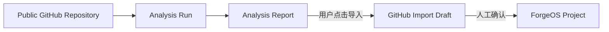
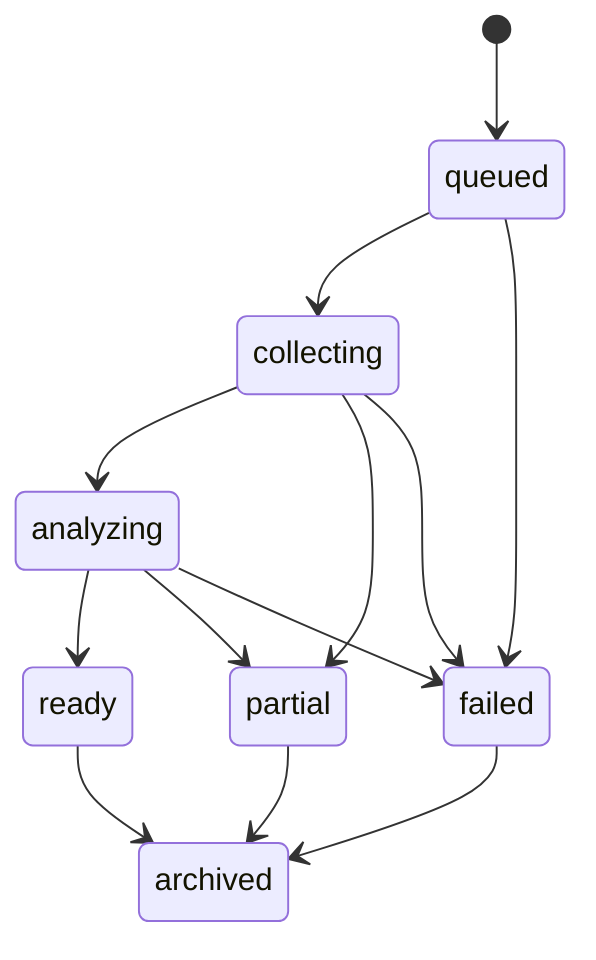

# ForgeOS GitHub Analysis Contract

- 状态：D9.1.1 rules-v2 质量强化已实现
- 适用范围：D9.1 GitHub Project Intelligence

实现说明：D9.1 已实现公开 Repository 的受限采集、确定性规则报告、历史、重新分析与归档；D9.1.1 增加仓库性质识别、产品技术栈与维护工具拆分、最近活动和章节可用性。AI 增强和导入衔接仍属于后续阶段。

## 1. 术语与生命周期边界

- **External Repository**：尚未成为 ForgeOS Project 的公开 GitHub Repository。
- **Analysis Run**：一次绑定 Repository、默认分支 HEAD、分析重点、Prompt 和分析器版本的不可变分析请求。
- **Analysis Source**：实际参与报告生成的受限、脱敏来源摘要。
- **Analysis Report**：外部项目理解结果，不是 ForgeOS 正式事实。
- **GitHub Import Draft**：用户决定接管 Repository 后的人工审核对象。
- **Project**：用户确认导入后进入 ForgeOS 研发记忆体系的正式项目。



Analysis、Import Draft、Project 是三个独立生命周期。分析成功不会自动创建 Draft，创建 Draft 也不会自动创建 Project。

## 2. Analysis Run 状态机



状态含义：

| 状态 | 含义 |
|---|---|
| `queued` | 请求已落库，尚未开始读取 GitHub。 |
| `collecting` | 正在读取元数据、Tree 和受限文本来源。 |
| `analyzing` | 已完成来源筛选，正在生成规则报告或用户主动请求的 AI 增强报告。 |
| `ready` | 在预算内获得满足最低完整度的报告。 |
| `partial` | 报告可读，但存在预算耗尽、Tree 截断、关键来源缺失或部分 API 失败。 |
| `failed` | 无法形成可用报告；失败不会创建 Import Draft 或 Project。 |
| `archived` | 用户归档的历史报告，只读保留。 |

可信度 `readiness` 与运行状态分离：

- `ready`：报告满足最低来源要求。
- `warning`：报告可使用，但包含非阻断质量警告。
- `incomplete`：来源不足，只能形成有限结论。
- `blocked`：安全或完整性问题阻止报告复制、AI 增强或导入。

## 3. 请求与幂等合同

```ts
type GitHubAnalysisFocus =
  | "overview"
  | "architecture"
  | "learning"
  | "reproduction"
  | "secondary_development"
  | "custom";

type GitHubAnalysisMode = "rules" | "ai";

interface StartGitHubAnalysisInput {
  workspaceId: string;
  repositoryUrl: string;
  focusType: GitHubAnalysisFocus;
  customPrompt?: string;
  analysisMode: GitHubAnalysisMode;
  aiProviderId?: string;
}

interface StartGitHubAnalysisResult {
  analysisRunId: string;
  reusedExistingRun: boolean;
}
```

`start_github_analysis` 必须先解析公开 Repository、默认分支和 HEAD SHA，再计算 `request_hash`。该 Hash 必须覆盖：

- Workspace ID。
- GitHub Repository ID。
- 默认分支 HEAD SHA。
- `focus_type`。
- 规范化后的自定义 Prompt Hash。
- `analysis_mode`。
- `analyzer_revision`。

相同请求返回已有 Run，不重复消耗 GitHub 或 AI 预算。HEAD 变化会形成新 Run，旧 Run 保留并标记为 stale。

## 4. 数据存储合同

计划 Migration：`0019_github_project_intelligence.sql`。

### `github_analysis_runs`

| 字段 | 合同 |
|---|---|
| `id` | UUID，主键。 |
| `workspace_id` | 必须引用现有 Workspace。 |
| `github_repository_id` | GitHub 稳定 Repository ID。 |
| `owner`, `name`, `repository_url` | 规范化公开仓库身份；URL 不得携带 Credential。 |
| `default_branch`, `source_commit_sha` | 报告绑定的默认分支与具体 HEAD。 |
| `focus_type` | 固定枚举。 |
| `custom_prompt` | 可空，最多 2,000 个 Unicode 字符，落库前脱敏。 |
| `status` | 固定运行状态枚举。 |
| `analysis_mode` | `rules / ai`。 |
| `readiness` | `ready / warning / incomplete / blocked`。 |
| `analyzer_revision` | 规则与 Schema 版本。 |
| `request_hash` | 幂等指纹；同 Workspace 唯一。 |
| `report_json` | 满足本文 Schema 的结构化报告。 |
| `report_markdown` | 由同一结构化报告确定性渲染。 |
| `content_hash` | 对最终安全 Markdown 计算。 |
| `imported_project_id` | 可空；只有人工导入完成后填写。 |
| `started_at`, `completed_at`, `created_at`, `updated_at` | UTC ISO-8601。 |
| `version` | 乐观并发版本。 |

### `github_analysis_sources`

| 字段 | 合同 |
|---|---|
| `id` | UUID，主键。 |
| `analysis_run_id` | 级联引用 Analysis Run。 |
| `source_type` | 固定来源类型枚举。 |
| `source_path` | Repository 相对路径；Repository 级元数据使用空字符串。 |
| `source_sha` | GitHub Blob/Commit SHA；无 SHA 的元数据可空。 |
| `content_hash` | 脱敏后摘要的稳定 Hash。 |
| `excerpt` | 受限、脱敏摘要，不是完整源码。 |
| `source_order` | 确定性排序。 |

来源类型：

```text
metadata / tree / readme / documentation / manifest / license /
workflow / test_config / build_config / release / commit / sbom / entrypoint
```

约束：同一 Analysis Run 下 `(source_type, source_path)` 唯一。不保存完整源码、二进制、本地路径、Token、Credential、Diff 或 GitHub 写操作结果。

## 5. 报告 Schema

所有结论使用相同引用结构：

```ts
type Confidence = "high" | "medium" | "low";

interface SourcedConclusion<T> {
  value: T;
  confidence: Confidence;
  sourceIds: string[];
}

interface GitHubAnalysisReport {
  repository: {
    owner: string;
    name: string;
    url: string;
    defaultBranch: string;
    headCommitSha: string;
  };
  overview: SourcedConclusion<string> | null;
  capabilities: Array<SourcedConclusion<string>>;
  techStack: Array<SourcedConclusion<string>>;
  architecture: Array<SourcedConclusion<{
    name: string;
    responsibility: string;
    keyPaths: string[];
  }>>;
  entrypoints: Array<SourcedConclusion<{ path: string; purpose: string }>>;
  buildAndRun: Array<SourcedConclusion<string>>;
  testStrategy: Array<SourcedConclusion<string>>;
  dependencies: SourcedConclusion<{
    packageManagers: string[];
    directDependencyCount: number | null;
    sbomAvailable: boolean;
    summary: string;
  }> | null;
  license: SourcedConclusion<{
    identifier: string | null;
    reuseGuidance: string;
  }> | null;
  risks: Array<SourcedConclusion<string>>;
  recommendedReadingOrder: Array<SourcedConclusion<string>>;
  reproductionAssessment: SourcedConclusion<{
    difficulty: "low" | "medium" | "high" | "unknown";
    prerequisites: string[];
    caveats: string[];
  }>;
  extensionPoints: Array<SourcedConclusion<string>>;
  userQuestionAnswer: SourcedConclusion<string> | null;
  completeness: {
    readiness: "ready" | "warning" | "incomplete" | "blocked";
    filesSelected: number;
    filesSkipped: number;
    treeEntriesSeen: number;
    sourceBytes: number;
  };
  qualityWarnings: GitHubAnalysisWarning[];
}
```

规则：

- 每个非空结论必须至少引用一个属于当前 Run 的真实 `sourceId`。
- 引用不存在、跨 Run 或被安全策略阻断时，结论必须被拒绝。
- AI 可以改写和组织已选来源，但不能制造无来源结论。
- 规则报告和 AI 报告使用同一 Schema、同一引用验证器和同一 Markdown Renderer。
- 构建、运行、测试、License 和复现难度都只能表述为“静态分析判断”，不得宣称已经实际执行或验证。

字段与允许来源：

| 报告字段 | 首选来源类型 | 降级来源 | 置信度上限规则 |
|---|---|---|---|
| `overview`、`capabilities` | readme、documentation、metadata | manifest | 只有 metadata 时最高为 `medium`。 |
| `repositoryKind` | readme、tree、manifest、release、workflow | metadata | 必须明确区分源码、库、Monorepo、发布索引、文档和模板仓库。 |
| `productTechStack` | 产品源码、产品 manifest、可靠文档 | readme | Workflow、格式化脚本和发布脚本不得进入产品技术栈。 |
| `repositoryToolingStack` | manifest、workflow、build_config | documentation | 只说明仓库维护方式，不代表产品实现。 |
| `techStack` | v1 兼容字段 | 无 | v2 写入与 `productTechStack` 相同内容，旧报告保持不变。 |
| `architecture` | tree、documentation、manifest | readme、entrypoint | 未读取入口或模块配置时最高为 `medium`。 |
| `entrypoints` | entrypoint、manifest、build_config | readme | 只有 README 命令时最高为 `low`。 |
| `buildAndRun` | build_config、manifest、workflow | readme | 从未实际执行，任何结论最高为 `medium`。 |
| `testStrategy` | test_config、workflow、tree | readme | 从未实际执行，任何结论最高为 `medium`。 |
| `dependencies` | sbom、manifest | workflow | 无 SBOM 时必须标记 Manifest fallback。 |
| `license` | license、metadata | readme | 无 License 文件时不能推定明确许可证。 |
| `risks` | manifest、workflow、documentation、tree | readme、commit | 无直接证据的风险不得进入报告。 |
| `recommendedReadingOrder` | tree、entrypoint、documentation | readme、manifest | 必须引用被推荐的真实路径来源。 |
| `reproductionAssessment` | build_config、manifest、test_config、documentation | readme、workflow | 因未执行，最高为 `medium`。 |
| `extensionPoints` | architecture、entrypoint、documentation | tree、manifest | 仅目录命名推断时最高为 `low`。 |
| `userQuestionAnswer` | 与问题相关的任意已选来源 | 无 | 无可引用来源时返回 `null`。 |

## 6. 来源优先级与预算

固定预算：

- 最多处理 20,000 个 Tree Entry。
- 最多读取 64 个文本文件。
- 单文件最大 128 KiB。
- 总文本最大 2 MiB。
- AI 输入最多 60,000 个 Unicode 字符。
- 用户自定义问题最多 2,000 个 Unicode 字符。

GitHub 递归 Tree 的平台上限目前为 100,000 项和 7 MB；ForgeOS 使用更低的 20,000 项产品预算。响应 `truncated = true` 时必须标记 `partial`，不能宣称已检查完整 Repository。参考 [Git Trees API](https://docs.github.com/en/rest/git/trees)。

来源选择优先级：

1. Repository metadata、默认分支、HEAD、License。
2. README 与根目录文档。
3. Manifest、Workspace/Module 配置与现有 SBOM。
4. 构建、测试和 Workflow 配置。
5. 入口文件和架构关键目录中的代表性文本。
6. Release 与最近 Commit 元数据。

默认排除：

- `.git`、`node_modules`、`vendor`、`target`、`dist`、`build`。
- 二进制、图片、视频、压缩包、模型和数据集。
- Minified、生成代码、超大 Lockfile 原文。
- `.env` 和疑似密钥文件。

超限、Tree 截断、关键文件读取失败或没有足够可分析文本时，Run 必须进入 `partial + incomplete` 或 `failed`，并返回具体警告。无 License、无 SBOM，以及存在其他可靠来源时的无 README 仅产生 `ready + warning`。SBOM 只读取已有的 SPDX 兼容导出；缺失时使用 Manifest 静态摘要，不请求生成新 SBOM。参考 [GitHub SBOM API](https://docs.github.com/en/rest/dependency-graph/sboms)。

### D9.1.1 报告兼容与状态语义

- 旧 `github-rules-v1` JSON、Markdown 和 Hash 永久保留，读取时使用兼容默认值。
- 新报告固定为 `analyzer_revision = github-rules-v2` 与 `schemaVersion = github-report-v2`。
- 相同 HEAD 由 v1 重新分析时，因为 Analyzer Revision 进入 Request Hash，只创建一个新的 v2 Run。
- `license_missing`、`sbom_missing` 和成功清理的提示包装是提示型警告，不降低 Run 为 Partial。
- Tree 截断、采集预算耗尽、关键来源失败和无可靠文本属于覆盖不完整。
- Secret 无法安全处理或 Source ID 校验失败属于安全阻断。
- 每个 v2 章节必须提供 `available`、`source_not_present`、`not_applicable`、`budget_limited` 或 `static_analysis_insufficient`，页面不得只显示裸横线。

## 7. 安全合同

1. Repository 的所有文本都是不可信数据，永远不能成为系统指令或开发授权。
2. AI Provider 只能接收筛选、脱敏后的结构化来源；不获得 Tool Calling、Shell、Credential、本地文件或 GitHub 写权限。
3. SQLite 和 AI 输入前都必须执行 Secret、Authorization、Token、密码、绝对路径和提示词包装脱敏。
4. 不保存完整源文件、原始 API 响应、二进制、Diff 或用户 Credential。
5. GitHub Token 继续存入 Windows Credential Manager，禁止进入 SQLite、日志、IPC 返回和报告。
6. 只允许 GitHub 读取接口。禁止创建 Tree、Commit、Issue、PR、Release、Fork、Webhook 或其他远程对象。
7. D9 不调用 `git clone`，不运行 Repository 命令，不下载 Release Artifact。
8. 安全策略触发后宁可返回 `blocked`，也不能生成看似完整的报告。

## 8. API 预算与缓存

GitHub 对公开数据的未认证主限额为每小时 60 次；个人访问令牌通常为每小时 5,000 次。ForgeOS 必须读取并展示剩余预算与重置时间，且同时尊重 GitHub 的 secondary rate limits。参考 [GitHub REST API Rate Limits](https://docs.github.com/en/rest/using-the-rest-api/rate-limits-for-the-rest-api)。

缓存键为 Repository ID + HEAD SHA + Request Hash。缓存命中时不得重新调用 GitHub 或 AI。

遇到限流时：

- 当前 Run 标记 `partial` 或 `failed`。
- 保存脱敏的错误码、剩余预算和重置时间。
- 前端显示可重试时间。
- 不自动循环重试，不在后台等待，不切换到克隆方案。

## 9. IPC 与事件合同

冻结 IPC 名称：

- `start_github_analysis`
- `get_github_analysis_status`
- `get_github_analysis_report`
- `list_github_analyses`
- `reanalyze_github_project`
- `archive_github_analysis`
- `import_github_analysis`

冻结 DTO：

```ts
type GitHubAnalysisErrorCode =
  | "github_analysis_invalid_url"
  | "github_analysis_public_only"
  | "github_analysis_not_found"
  | "github_analysis_rate_limited"
  | "github_analysis_tree_truncated"
  | "github_analysis_budget_exceeded"
  | "github_analysis_source_unavailable"
  | "github_analysis_prompt_rejected"
  | "github_analysis_ai_unavailable"
  | "github_analysis_ai_invalid"
  | "github_analysis_stale"
  | "github_analysis_version_conflict"
  | "github_analysis_storage_error"
  | "github_analysis_blocked";

interface GitHubAnalysisLocator {
  workspaceId: string;
  analysisRunId: string;
}

interface GitHubAnalysisStatusDto {
  analysisRunId: string;
  status: "queued" | "collecting" | "analyzing" | "ready" | "partial" | "failed" | "archived";
  readiness: "ready" | "warning" | "incomplete" | "blocked";
  stage: "resolving" | "collecting_tree" | "reading_sources" | "rules_analysis" | "ai_analysis" | "persisting" | null;
  defaultBranch: string;
  sourceCommitSha: string;
  stale: boolean;
  treeEntriesSeen: number;
  filesRead: number;
  filesSkipped: number;
  apiRequestsUsed: number;
  apiRequestsRemaining: number | null;
  aiInvoked: boolean;
  startedAt: string | null;
  completedAt: string | null;
  errorCode: GitHubAnalysisErrorCode | null;
  errorSummary: string | null;
  version: number;
}

interface GetGitHubAnalysisReportInput extends GitHubAnalysisLocator {}

interface GetGitHubAnalysisReportResult {
  status: GitHubAnalysisStatusDto;
  report: GitHubAnalysisReport | null;
  contentMarkdown: string | null;
  contentHash: string | null;
}

interface ListGitHubAnalysesInput {
  workspaceId: string;
  cursor?: string;
  limit?: number;
}

interface ListGitHubAnalysesResult {
  items: GitHubAnalysisStatusDto[];
  nextCursor: string | null;
}

interface ReanalyzeGitHubProjectInput extends GitHubAnalysisLocator {
  analysisMode: "rules" | "ai";
  aiProviderId?: string;
}

interface ArchiveGitHubAnalysisInput extends GitHubAnalysisLocator {
  expectedVersion: number;
}

interface ImportGitHubAnalysisInput extends GitHubAnalysisLocator {
  expectedVersion: number;
  acknowledgePartial: boolean;
}

interface ImportGitHubAnalysisResult {
  analysisRunId: string;
  importDraftId: string;
  reusedExistingDraft: boolean;
}
```

列表默认 20 项、最大 50 项，游标不透明且按 `created_at DESC, id DESC` 稳定排序。所有请求都必须验证 Workspace 隔离。`archive_github_analysis` 只接受 `ready / partial / failed`；运行中的 Run 不能归档。`import_github_analysis` 只接受 `ready / partial`，`partial` 必须显式确认，`blocked` 永远不能导入。

`start_github_analysis` 立即返回 `analysisRunId`，采集与分析异步执行。`reanalyze_github_project` 创建或复用新 Run，不覆盖旧报告。`import_github_analysis` 只创建/更新现有 GitHub Import Draft，并要求后续人工确认。

冻结事件：

- `github-analysis://progress`
- `github-analysis://completed`

```ts
interface GitHubAnalysisProgressEvent {
  analysisRunId: string;
  stage: "resolving" | "collecting_tree" | "reading_sources" | "rules_analysis" | "ai_analysis" | "persisting";
  message: string;
  treeEntriesSeen: number;
  filesRead: number;
  filesSkipped: number;
  apiRequestsUsed: number;
  apiRequestsRemaining: number | null;
  aiInvoked: boolean;
}
```

## 10. 错误码

| 错误码 | 用户含义 | 行为 |
|---|---|---|
| `github_analysis_invalid_url` | 不是可识别的 GitHub Repository URL。 | 不创建 Run。 |
| `github_analysis_public_only` | Repository 不是公开可读项目。 | 阻止分析。 |
| `github_analysis_not_found` | Repository 不存在或不可访问。 | 失败，不创建 Draft。 |
| `github_analysis_rate_limited` | GitHub API 预算不足。 | 显示重置时间，不自动重试。 |
| `github_analysis_tree_truncated` | GitHub 返回了不完整 Tree。 | 生成部分报告并明确警告。 |
| `github_analysis_budget_exceeded` | 超出 ForgeOS 文件或文本预算。 | 停止继续采集，标记 partial。 |
| `github_analysis_source_unavailable` | 关键来源读取失败。 | 可降级则 partial，否则 failed。 |
| `github_analysis_prompt_rejected` | 自定义问题超长或触发安全策略。 | 不调用 AI。 |
| `github_analysis_ai_unavailable` | AI 未配置、禁用或调用失败。 | 回退规则报告。 |
| `github_analysis_ai_invalid` | AI 输出或来源引用无效。 | 丢弃 AI 结果，回退规则报告。 |
| `github_analysis_stale` | 默认分支 HEAD 已变化。 | 保留旧报告，允许用户重新分析。 |
| `github_analysis_version_conflict` | 报告状态已在其他窗口变化。 | 重新加载，不覆盖。 |
| `github_analysis_storage_error` | 无法安全保存 Run 或来源。 | 整体回滚。 |
| `github_analysis_blocked` | 检测到无法安全输出的内容。 | 禁止复制、AI 增强和导入。 |

中文和英文语言资源必须使用相同错误码键集合。内部 GitHub 错误正文放入技术详情，不直接作为主要用户提示。

## 11. 页面与交互合同

路由：

- `/github-import`：Repository URL 输入、分析历史、现有导入兼容入口。
- `/github-import/analyses/:analysisId`：结构化报告详情。

“添加项目”固定提供：

1. 新建个人项目。
2. 导入自己的 GitHub 项目。
3. 分析一个 GitHub 项目。

状态矩阵：

| 页面状态 | 主要展示 | 主操作 |
|---|---|---|
| 初始输入 | URL、分析重点、可选问题、规则/AI 模式。 | 开始分析 |
| 正在采集 | Tree、文件、跳过数和 API 预算。 | 无 |
| 规则分析 | 正在生成带来源的确定性报告。 | 无 |
| AI 增强 | 明确 AI 已由用户启用，失败会回退规则报告。 | 无 |
| 完成 | 完整度、结构化章节和来源引用。 | 导入为 ForgeOS 项目 |
| 部分完成 | 可用章节与缺失来源说明。 | 导入为 ForgeOS 项目 |
| 限流 | 重置时间与已保存进度。 | 到时后重新分析 |
| 仓库不存在 | 可操作的 URL/权限提示。 | 修改地址 |
| 分析失败 | 阶段、错误原因和安全重试入口。 | 重新分析 |
| 报告过期 | 原 HEAD、当前 HEAD 与差异说明。 | 重新分析 |

报告页唯一主操作为“导入为 ForgeOS 项目”。重新分析、复制报告和归档为次级操作。任何页面都不得出现克隆、运行、复现执行、Fork、Push、PR 或自动二开按钮。

### 本地化键合同

中文和英文资源必须具有相同键集合，至少包括：

| Key | 简体中文 | English |
|---|---|---|
| `githubAnalysis.title` | GitHub 项目分析 | GitHub project analysis |
| `githubAnalysis.description` | 在导入前了解公开项目的功能、结构和二开边界。 | Understand a public project before importing it. |
| `githubAnalysis.action.start` | 开始分析 | Start analysis |
| `githubAnalysis.action.import` | 导入为 ForgeOS 项目 | Import as ForgeOS project |
| `githubAnalysis.action.reanalyze` | 重新分析 | Analyze again |
| `githubAnalysis.action.copy` | 复制报告 | Copy report |
| `githubAnalysis.action.archive` | 归档报告 | Archive report |
| `githubAnalysis.state.collecting` | 正在采集项目资料 | Collecting project sources |
| `githubAnalysis.state.rules` | 正在整理规则报告 | Building rules report |
| `githubAnalysis.state.ai` | 正在进行 AI 增强 | Enhancing with AI |
| `githubAnalysis.state.ready` | 分析完成 | Analysis ready |
| `githubAnalysis.state.partial` | 部分完成 | Partially complete |
| `githubAnalysis.state.rateLimited` | GitHub 请求额度暂时不足 | GitHub rate limit reached |
| `githubAnalysis.state.notFound` | 找不到这个公开仓库 | Public repository not found |
| `githubAnalysis.state.failed` | 分析失败 | Analysis failed |
| `githubAnalysis.state.stale` | 仓库已有新版本 | Repository has a newer HEAD |

所有 `GitHubAnalysisErrorCode` 也必须在 `zh-CN` 与 `en-US` 中逐项存在。Repository 自身内容、文件名、Commit Message 和报告引用不翻译。

## 12. 验收合同

D9.1 实现至少覆盖：

- Public Repository 的无认证与认证只读分析。
- 无 README、无 License、无 SBOM、Monorepo、二进制仓库和 Tree 截断。
- Prompt Injection、疑似 Secret、超大文件和超预算 Repository。
- 规则模式始终可用；AI 失败可靠回退。
- 相同请求幂等；HEAD 变化生成新报告并保留旧报告。
- 每个结论来源真实、同 Run、可定位。
- Analysis 不自动创建 Import Draft 或 Project。
- 不产生 GitHub 写请求，不克隆，不执行外部代码。
