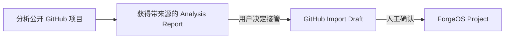

# ForgeOS 产品设计基线 v0.1

- 状态：已冻结
- 当前工程阶段：D0
- 目标用户：同时维护多个软件项目并使用 Git、GitHub 和 Codex 的独立开发者

## 产品定位

ForgeOS 是 **Personal AI-Assisted Engineering Operating System**。

它位于代码仓库、GitHub 和 AI 编程助手之上，负责保存项目意图、当前状态、研发过程、决策理由和验证证据。

## 不可替代价值

ForgeOS 的核心价值是：

> 建立项目隔离、人工确认、证据可追溯的研发记忆，并把它转换为开发者和 Codex 都能可靠使用的上下文。

它重点回答：

- 项目现在是什么状态？
- 上一次工作完成了什么？
- 下一次应从哪里继续？
- 某项技术决策为什么被采用？
- 某个问题经过了哪些排查？
- 某项成果是否已经验证？
- Codex 本次工作需要哪些上下文？

## 产品边界

ForgeOS 不是：

- Todo 或 GTD 工具
- Jira 或 GitHub Issues 替代品
- 普通笔记软件
- AI 聊天工具
- IDE 或代码托管平台
- 无人监督的自动开发 Agent

## MVP 核心对象

### Project

保存项目身份、目标、范围、技术栈和约束。

### Current Snapshot

表达项目当前的可信状态，包括当前目标、已验证成果、阻塞和最多三个下一步。

### Development Session

记录一次研发工作的目标、结果、验证和接手信息。

### Decision

记录技术决策的背景、候选方案、权衡、选择和长期影响。

### Problem

记录问题现象、环境、排查尝试、根因、解决方案和验证。

### Evidence

保存支持成果、决策和问题结论的文件、链接、测试、Commit 或其他证据。

### Context Export

从单一项目的已确认记录中生成可供 Codex 使用的 Markdown Context Pack。

## MVP 必须具备

- 单用户
- 本地优先
- Windows 桌面应用
- 项目级数据隔离
- 人工确认正式事实
- 记录版本和来源
- 基础搜索
- 一致性备份与恢复
- 确定性 Context Export

## 推迟实现

- 通用任务、看板、Sprint、工时和 Backlog
- Git 自动采集
- GitHub 同步
- AI 主动分析
- 自动维护 `AGENTS.md`
- ForgeOS MCP Server
- Codex 自动任务执行
- 多用户和多设备同步
- 向量数据库
- 移动端、云服务和插件系统

## 产品原则

1. Project 是所有研发记录的归属边界。
2. Current Snapshot 与历史事件分离。
3. 原始证据、人工确认事实和 AI 候选必须分层。
4. AI 不得静默修改正式事实。
5. Context Pack 默认只能包含一个项目。
6. 一次记录应能服务开发交接、复盘和职业材料。
7. 产品首页围绕状态、阻塞、成果和新鲜度，而不是任务数量。
8. 所有核心能力在无 AI、无网络时仍可使用。

## 防止退化为任务管理软件

- 不建立通用 Task 数据模型。
- 不提供 Kanban、燃尽图或任务完成百分比。
- Project 首页默认展示 Current Snapshot。
- Snapshot 的下一步最多三项，且不形成独立待办系统。
- Development Session 固定围绕“目标、行动、结果、验证、接手”。
- 项目进展使用已验证成果、阻塞和状态新鲜度表达。

## MVP 成功标准

- 60 秒内恢复一个项目的上下文
- 两分钟内完成一次 Development Session 收尾
- 已确认事实能够追溯到来源和版本
- Context Pack 不出现跨项目上下文污染
- 离线状态下核心流程完整可用

## D0 边界

D0 只验证工程基础和 Windows 构建链路，不实现上述业务对象的完整功能。任何超出 D0 的能力都必须等待当前阶段验收后再开始。

## D7 产品聚焦

ForgeOS 的当前产品表述收敛为：

> 帮助个人开发者管理多项目研发上下文，并让自己和 Codex 随时理解项目身份、当前状态、研发历史、成果与下一步。

项目主流程只保留四个一级页面：

1. 概览：项目身份、最新观察、已确认状态和下一步。
2. 研发历史：按一次研发活动聚合 Codex、Git 与人工记录。
3. 成果与资料：区分正式成果和支持性资料。
4. AI 项目上下文：生成可供 Codex 与其他 AI 直接使用的稳定上下文。

Snapshot、Repository 和 Pulse 审核继续作为高级维护能力。AI Candidate、Codex Task Proposal 与 Execution Record 冻结为只读兼容能力，不再进入主流程。ForgeOS 不执行 Codex、不管理通用任务、不执行 Git 写操作。

新的核心成功标准：

- 在项目列表中快速判断应继续哪个项目。
- 打开项目后 60 秒内理解定位、当前目标、问题和下一步。
- 数百条 Codex Turn 以少量研发活动展示，而不是逐条平铺。
- 系统生成的成果始终是草稿，只有人工确认后进入正式研发记忆。
- Codex 可以通过仓库目录自动定位唯一 ForgeOS Project，并读取严格隔离的上下文。

## D9.0 GitHub 项目分析定位

ForgeOS 在不改变“个人研发记忆助手”主线的前提下，增加一个前置理解能力：用户可以先分析一个公开 GitHub 项目，再决定是否把它接管为自己的 ForgeOS Project。

这一能力不是“万能 GitHub 客户端”，也不是代码运行平台。它回答的是：

- 这个项目解决什么问题，有哪些主要功能？
- 代码、模块和入口大致如何组织？
- 使用什么技术栈，如何构建、运行和测试？
- License、依赖和二次开发有哪些注意事项？
- 如果想学习、复现或二开，推荐从哪里开始阅读？

### 三段式产品流程

边界：

- Analysis Report 是外部项目理解结果，不是 Snapshot、Session、Evidence 或 Achievement。
- 分析不要求先创建 Project，也不会自动污染项目列表。
- 只有用户主动点击“导入为 ForgeOS 项目”，才进入现有导入与 Project 创建流程。
- D9 仅支持公开 Repository；默认不克隆、不运行、不持续同步。
- 规则报告始终可用；D9.1 只提供本地确定性规则报告，AI 增强延后。
- 报告绑定默认分支的具体 HEAD Commit，HEAD 变化时保留旧报告并提示重新分析。

### 成功标准

- 用户输入公开 Repository URL 后，可以获得结构化且可追溯的项目理解报告。
- 报告的每个非空结论都能回到真实来源，而不是无依据的 AI 推断。
- 大型、不完整或受限 Repository 明确显示“部分完成”，不伪装成完整分析。
- 用户可以在充分理解后导入项目，但分析本身不会创建正式研发事实。
- Project A、Project B 与外部 Analysis Run 继续保持清晰边界。

### D9.1 明确不做

- 私有 Repository。
- Clone、Fork、Checkout、Commit、Push、PR 或 Release 写操作。
- Shell、构建、测试、复现执行或 Codex 自动二开。
- Webhook、后台持续同步和 Agent。
- 将外部项目报告自动写入正式 Project 事实。
- AI 增强和“导入为 Project”衔接。
